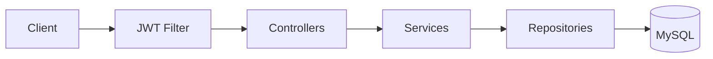
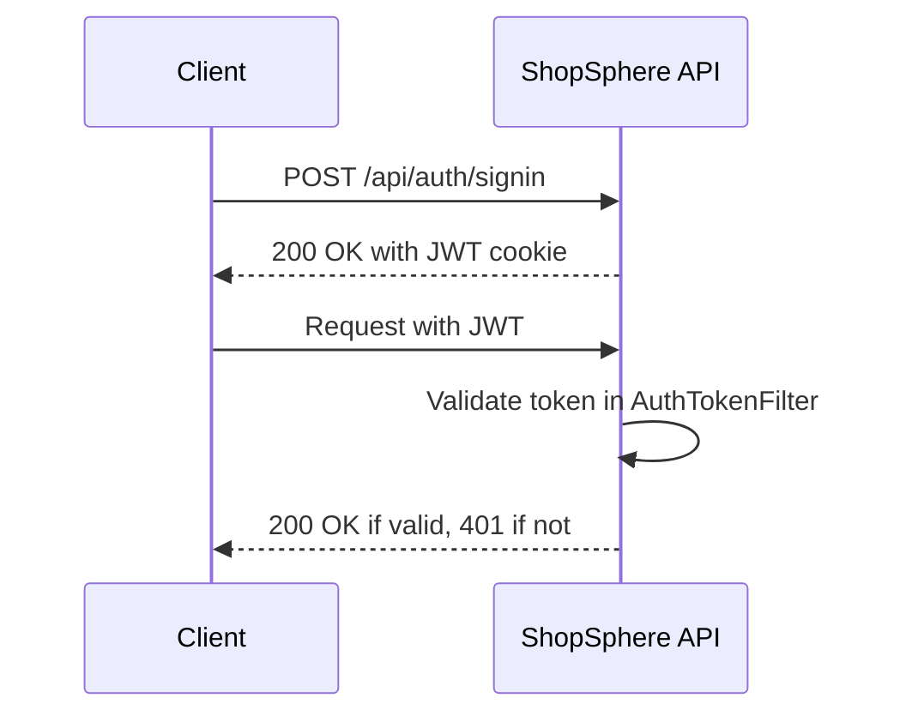
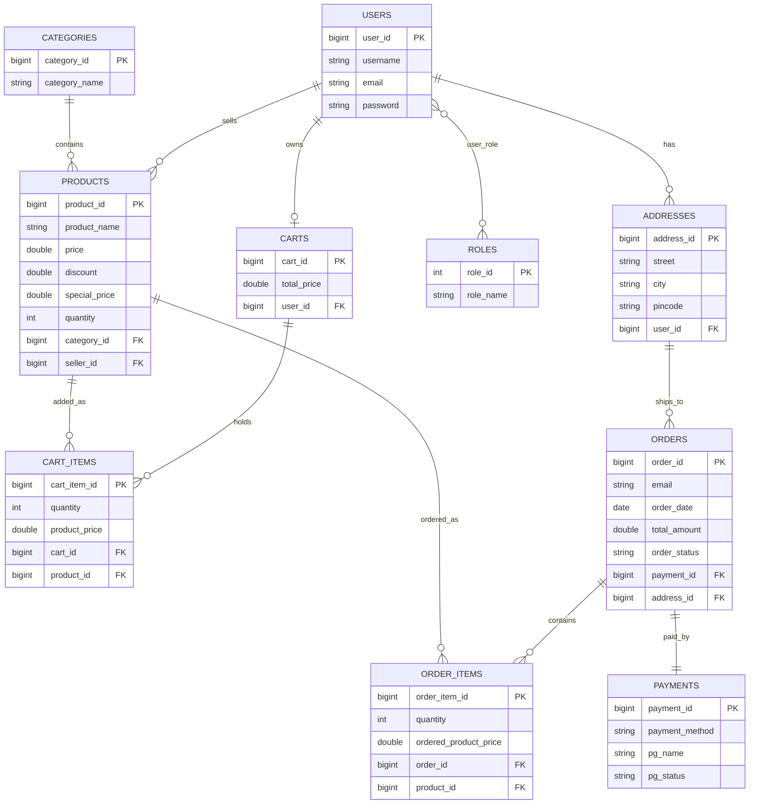
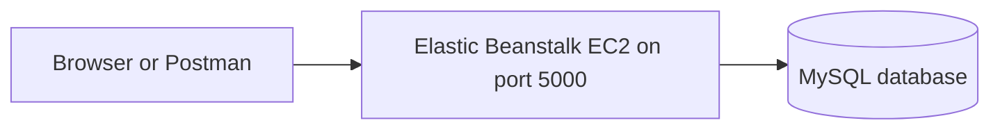

<h1 align="center">🛍️ ShopSphere – Spring Boot E-Commerce REST API</h1>
<p align="center">
  A secure e-commerce backend built with <b>Spring Boot 3</b>, <b>Spring Security + JWT</b>, <b>JPA/Hibernate</b> and <b>MySQL</b>,<br/>
  documented with <b>Swagger (OpenAPI 3)</b> and deployed on <b>AWS</b>.
</p>
<p align="center">
  
  
  
  
  
  
</p>
<p align="center">
  <a href="http://my-app-env.eba-zdvy2nem.ap-southeast-2.elasticbeanstalk.com/swagger-ui/index.html"><b>🔗 Live Swagger API Documentation</b></a>
</p>

ShopSphere --- E-Commerce REST API
A Spring Boot backend for an e-commerce application
Built with Java 21, Spring Boot, Spring Security, JWT, Spring Data JPA,
and MySQL.
GitHub Profile ·
Repository
· Live Swagger
UI
:::
---
Overview
ShopSphere is a RESTful e-commerce backend organized around a layered
architecture. It exposes APIs for user authentication, product and
category management, shopping carts, customer addresses, and order
placement. The codebase separates HTTP handling, business logic, and
database access into controller, service, and repository layers.

## Table of Contents

- [About](#about)
- [Features](#features)
- [Tech Stack](#tech-stack)
- [Architecture](#architecture)
- [Project Structure](#project-structure)
- [Database Design](#database-design)
- [API Reference](#api-reference)
- [Getting Started](#getting-started)
- [Configuration](#configuration)
- [Authentication Guide](#authentication-guide)
- [Error Handling](#error-handling)
- [Deployment](#deployment)
- [Author](#author)

---

## About

ShopSphere is the backend of an online store. Users register and sign in, browse products by category, search by keyword, keep a shopping cart, save delivery addresses and place orders with payment-gateway details. Product images can be uploaded, and stock is tracked automatically.

The project demonstrates a clean Controller, Service and Repository architecture, DTO-based request and response handling, stateless JWT security, global exception handling, pagination with sorting, and cloud deployment.

---

## Features

- JWT authentication: sign up, sign in, sign out and current-user info
- Token works as an HTTP cookie or as an Authorization Bearer header
- BCrypt password hashing and stateless sessions
- Role model: ROLE_USER, ROLE_SELLER and ROLE_ADMIN, assigned at signup
- Categories: create, list with pagination and sorting, update, delete
- Products: add to a category, list, filter by category, search by keyword, update, delete, image upload
- Pricing: special price is calculated from price and discount percentage
- Shopping cart: add items, increase or decrease quantity, remove items, automatic total price, stock validation
- Address book: full CRUD, multiple addresses per user
- Orders: checkout from the cart, stock is reduced and the cart is cleared
- Global exception handling and bean validation with clear error messages
- Interactive Swagger UI documentation
- Deployed on AWS Elastic Beanstalk with a MySQL database

---

## Tech Stack

| Layer | Technology |
|---|---|
| Language | Java 21 |
| Framework | Spring Boot 3.2.5 (Web, Data JPA, Validation) |
| Security | Spring Security, JWT (jjwt 0.12.5), BCrypt |
| Database | MySQL |
| ORM | Hibernate and Spring Data JPA |
| DTO mapping | ModelMapper 3.0.0 |
| API docs | springdoc-openapi 2.5.0 (Swagger UI) |
| Build tool | Maven (wrapper included) |
| Utilities | Lombok |
| Cloud | AWS Elastic Beanstalk (EC2) |

---

## Architecture

### Request flow



Every module (Address, Auth, Cart, Category, Order, Product) follows the same Controller, Service, Repository flow. Entities are never exposed directly; requests and responses use DTOs converted with ModelMapper.

### Authentication flow



---

## Project structure

``` text
sb-ecom/
├── src/
│   ├── main/
│   │   ├── java/com/ecommerce/project/
│   │   │   ├── config/                  # App configuration and Swagger
│   │   │   ├── controller/              # Address, Auth, Cart, Category,
│   │   │   │                            # Order, and Product controllers
│   │   │   ├── exceptions/              # Custom exceptions and global handler
│   │   │   ├── model/                   # JPA entities and role model
│   │   │   ├── payload/                 # DTOs and response objects
│   │   │   ├── repositories/            # Spring Data JPA repositories
│   │   │   ├── security/
│   │   │   │   ├── jwt/                 # JWT filter, utilities, entry point
│   │   │   │   ├── request/             # Login and signup payloads
│   │   │   │   ├── response/            # Authentication/user responses
│   │   │   │   └── services/            # User-details services
│   │   │   ├── service/                 # Service interfaces/implementations
│   │   │   ├── util/                    # Shared utilities
│   │   │   └── SbEcomApplication.java   # Application entry point
│   │   └── resources/
│   │       └── application.properties   # Environment-based configuration
│   └── test/
├── images/                              # Architecture and API diagrams
├── .gitignore
├── mvnw
├── mvnw.cmd
└── pom.xml
```

---

## Database Design

Tables are created automatically by Hibernate (ddl-auto=update).



---

## API Reference

Interactive documentation: [Swagger UI](http://my-app-env.eba-zdvy2nem.ap-southeast-2.elasticbeanstalk.com/swagger-ui/index.html)

Access meaning: **Public** needs no login. **Login** needs a valid JWT.

List endpoints accept these query parameters: `pageNumber` (default 0), `pageSize` (default 50), `sortBy` and `sortOrder` (asc or desc).

### Authentication

| Method | Endpoint | Description | Access |
|---|---|---|---|
| POST | `/api/auth/signup` | Register a new user | Public |
| POST | `/api/auth/signin` | Sign in and receive the JWT cookie | Public |
| POST | `/api/auth/signout` | Sign out and clear the cookie | Public |
| GET | `/api/auth/username` | Current username | Public |
| GET | `/api/auth/user` | Current user id, username and roles | Login |

### Categories

| Method | Endpoint | Description | Access |
|---|---|---|---|
| GET | `/api/public/categories` | List categories | Public |
| POST | `/api/public/categories` | Create a category | Public |
| PUT | `/api/public/categories/{categoryId}` | Update a category | Public |
| DELETE | `/api/admin/categories/{categoryId}` | Delete a category | Login |

### Products

| Method | Endpoint | Description | Access |
|---|---|---|---|
| POST | `/api/admin/categories/{categoryId}/product` | Add a product to a category | Login |
| GET | `/api/public/products` | List all products | Public |
| GET | `/api/public/categories/{categoryId}/products` | List products of a category | Public |
| GET | `/api/public/products/keyword/{keyword}` | Search products by keyword | Public |
| PUT | `/api/admin/products/{productId}` | Update a product | Login |
| PUT | `/api/products/{productId}/image` | Upload product image (form-data field: image) | Login |
| DELETE | `/api/admin/products/{productId}` | Delete a product | Login |

### Cart

| Method | Endpoint | Description | Access |
|---|---|---|---|
| POST | `/api/carts/products/{productId}/quantity/{quantity}` | Add a product to the cart | Login |
| GET | `/api/carts` | List all carts | Login |
| GET | `/api/carts/users/cart` | Cart of the logged-in user | Login |
| PUT | `/api/cart/products/{productId}/quantity/{operation}` | Use delete to decrease by 1, any other value increases by 1 | Login |
| DELETE | `/api/carts/{cartId}/product/{productId}` | Remove a product from the cart | Login |

### Addresses

| Method | Endpoint | Description | Access |
|---|---|---|---|
| POST | `/api/addresses` | Create an address | Login |
| GET | `/api/addresses` | List all addresses | Login |
| GET | `/api/addresses/{addressId}` | Get an address by id | Login |
| GET | `/api/users/addresses` | Addresses of the logged-in user | Login |
| PUT | `/api/addresses/{addressId}` | Update an address | Login |
| DELETE | `/api/addresses/{addressId}` | Delete an address | Login |

### Orders

| Method | Endpoint | Description | Access |
|---|---|---|---|
| POST | `/api/order/users/payments/{paymentMethod}` | Place an order from the current cart | Login |

### Sample request: sign up

```json
{
  "username": "john",
  "email": "john@example.com",
  "password": "secret123",
  "role": ["seller"]
}
```

The role field is optional. Use admin or seller; any other value gives ROLE_USER.

### Sample request: place an order

```http
POST /api/order/users/payments/UPI
```

```json
{
  "addressId": 1,
  "pgName": "Razorpay",
  "pgPaymentId": "pay_123456",
  "pgStatus": "success",
  "pgResponseMessage": "Payment successful"
}
```

## Getting Started

### Prerequisites

- Java 21
- MySQL 8 or newer
- Git (the Maven wrapper is included)

### 1. Clone the repository

```bash
git clone https://github.com/akashsonu0/shopsphere-springboot-ecommerce-api.git
cd shopsphere-springboot-ecommerce-api
```

### 2. Create the database

```sql
CREATE DATABASE ecommerce;
```

### 3. Create your configuration file

```bash
cp src/main/resources/application.properties.example src/main/resources/application.properties
```

Open the new file, set your MySQL username and password, and set a Base64 JWT secret. You can generate one with:

```bash
openssl rand -base64 64
```

The file application.properties is git-ignored, so your secrets are never published.

### 4. Run the application

```bash
./mvnw spring-boot:run
```

On Windows Command Prompt use `mvnw.cmd spring-boot:run`.

| What | URL |
|---|---|
| API base URL | `http://localhost:5000` |
| Swagger UI | `http://localhost:5000/swagger-ui/index.html` |

### Demo accounts

On first start the app creates the three roles and these demo users:

| Username | Roles |
|---|---|
| user1 | USER |
| seller1 | SELLER |
| admin | USER, SELLER, ADMIN |

Their passwords are set in `WebSecurityConfig.initData()`. Change or remove these accounts before any public deployment.

---

## Configuration

| Property | Environment variable (cloud) | Purpose |
|---|---|---|
| `spring.datasource.url` | `DB_URL` | JDBC URL of the database |
| `spring.datasource.username` | `DB_USERNAME` | Database user |
| `spring.datasource.password` | `DB_PASSWORD` | Database password |
| `spring.app.jwtSecret` | `JWT_SECRET` | Base64 secret used to sign tokens |
| `spring.app.jwtExpirationMs` | - | Token lifetime in milliseconds (default 3000000) |
| `project.image` | - | Folder for uploaded product images (default images/) |
| `server.port` | - | Server port (default 5000) |

---

## Authentication Guide

1. Create an account with `POST /api/auth/signup`, or use a demo account locally.
2. Call `POST /api/auth/signin`. The JWT is stored in the cookie named springBootEcom.
3. In Swagger UI the browser sends the cookie automatically on later requests.
4. In Postman or a frontend app, send the header `Authorization: Bearer <token>`.
5. Call `POST /api/auth/signout` to clear the cookie.

---

## Error Handling

All errors are handled by `MyGlobalExceptionHandler`.

| Situation | Status | Response |
|---|---|---|
| Resource not found | 404 | message and status fields |
| Business rule broken (duplicate, out of stock, empty cart) | 400 | message and status fields |
| Validation failure | 400 | map of field name to validation message |
| Wrong login credentials | 404 | message and status fields |

---

## Deployment

The application is packaged as a JAR and runs on AWS Elastic Beanstalk with a MySQL database.



Build the JAR:

```bash
./mvnw clean package -DskipTests
```

Upload `target/sb-ecom-0.0.1-SNAPSHOT.jar` to Elastic Beanstalk, then set the environment properties DB_URL, DB_USERNAME, DB_PASSWORD and JWT_SECRET so no secrets live in the repository.

---

## Author

**Akash Sonu**

GitHub: [akashsonu0](https://github.com/akashsonu0)

If you found this project useful, please give the repository a star.


