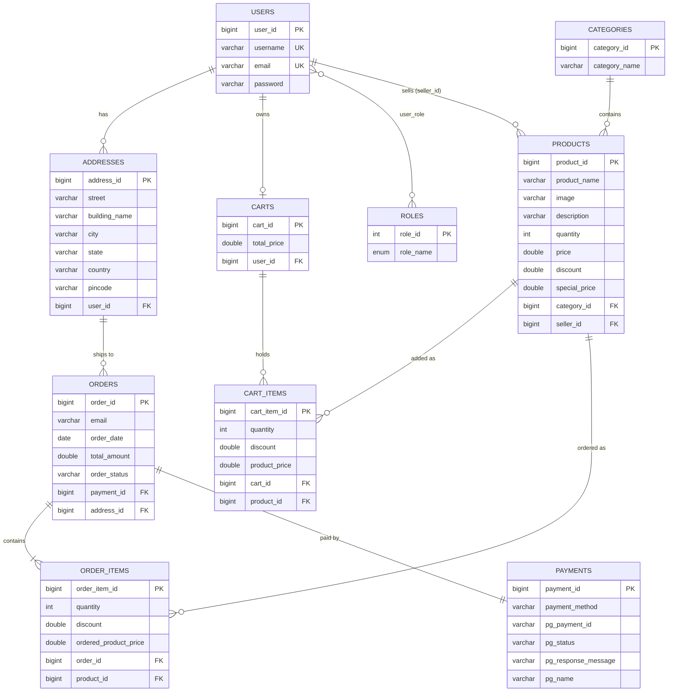

<h1 align="center">🛍️ ShopSphere – Spring Boot E-Commerce REST API</h1>
<p align="center">
  A secure e-commerce backend built with <b>Spring Boot 3</b>, <b>Spring Security + JWT</b>, <b>Spring Data JPA</b> and <b>MySQL</b>.<br/>
  Documented with <b>Swagger (OpenAPI 3)</b> and deployed on <b>AWS</b> (Elastic Beanstalk/EC2 + RDS).
</p>
<p align="center">
  
  
  
  
  
  
</p>
<p align="center">
  <a href="http://my-app-env.eba-zdvy2nem.ap-southeast-2.elasticbeanstalk.com/swagger-ui/index.html"><b>🔗 Live Swagger UI</b></a>
</p>
---
📑 Table of Contents
About
Features
Tech Stack
Architecture
Project Structure
Database Design
API Reference
Getting Started
Authentication Guide
Error Handling
Deployment
Roadmap
Author
---
📖 About
ShopSphere is the backend of an online store. Customers register and log in, browse products by category, search by keyword, manage a cart and delivery addresses, and place orders. Products carry a discount and an automatically calculated special price, stock is tracked, and product images can be uploaded.
The codebase is organised in clean layers (Controller → Service → Repository), exposes DTOs instead of entities, uses stateless JWT authentication, and has global exception handling and Swagger documentation.
---
✨ Features
🔐 JWT authentication – sign up, sign in, sign out; the token works as an HTTP cookie or as a `Bearer` header
🔑 BCrypt password hashing and stateless sessions
👥 User roles – `ROLE_USER`, `ROLE_SELLER`, `ROLE_ADMIN` (assigned at signup, returned on login, seeded demo accounts included)
🗂️ Categories – create, list with pagination and sorting, update, delete (duplicate names are rejected)
📦 Products – add to a category, update, delete, list, filter by category, search by keyword, image upload
💸 Pricing – special price is calculated from `price` and `discount` (%)
🛒 Cart – add products, increase/decrease quantity, remove items, total price kept in sync, stock validation
📍 Addresses – create, read, update, delete; fetch the logged-in user's addresses
🧾 Orders – checkout from the cart with payment method and payment-gateway details; stock is reduced and the cart is cleared
⚠️ Global exception handling and bean validation with clear error messages
📘 Swagger UI with Bearer authentication support
☁️ AWS deployment with MySQL on RDS
---
🧰 Tech Stack
Layer	Technology
Language	Java 21
Framework	Spring Boot 3.2.5 (Web, Data JPA, Validation, Security)
Authentication	JWT – jjwt 0.12.5
Database	MySQL (AWS RDS in production), H2 available for quick tests
ORM	Hibernate / Spring Data JPA
DTO mapping	ModelMapper 3.0.0
API docs	springdoc-openapi 2.5.0 (Swagger UI)
Build	Maven (wrapper included)
Boilerplate	Lombok
Cloud	AWS Elastic Beanstalk / EC2, RDS
---
🏗️ Architecture
Every module (Address, Auth, Cart, Category, Order, Product) follows the same flow:

DTO flow – entities never leave the server; requests and responses are DTOs converted with ModelMapper.

JWT flow

---
🗂️ Project Structure
```
shopsphere-springboot-ecommerce-api
├── src/main/java/com/ecommerce/project
│   ├── SbEcomApplication.java
│   ├── config            # AppConfig (ModelMapper), AppConstants (paging defaults), SwaggerConfig
│   ├── controller        # Address, Auth, Cart, Category, Order, Product
│   ├── exceptions        # APIException, ResourceNotFoundException, MyGlobalExceptionHandler
│   ├── model             # User, Role, AppRole, Address, Category, Product, Cart, CartItem,
│   │                     # Order, OrderItem, Payment
│   ├── payload           # DTOs and response wrappers (ProductResponse, CategoryResponse, ...)
│   ├── repositories      # Spring Data JPA repositories
│   ├── security
│   │   ├── jwt           # JwtUtils, AuthTokenFilter, AuthEntryPointJwt
│   │   ├── request       # LoginRequest, SignupRequest
│   │   ├── response      # MessageResponse, UserInfoResponse
│   │   ├── services      # UserDetailsImpl, UserDetailsServiceImpl
│   │   └── WebSecurityConfig.java
│   ├── service           # Service interfaces and implementations (incl. FileService)
│   └── util              # AuthUtil (current logged-in user helper)
├── src/main/resources
│   └── application.properties.example
├── images                # runtime folder for uploaded product images
├── docs/images           # README diagrams
└── pom.xml
```
---
🗃️ Database Design
Tables are generated automatically by Hibernate (`ddl-auto=update`).

---
📚 API Reference
🔗 Interactive docs: Swagger UI
Access legend: 🌐 Public (no login) · 🔒 Login required
> Paging query params for list endpoints: `pageNumber` (default `0`), `pageSize` (default `50`), `sortBy` (`categoryId` / `productId`), `sortOrder` (`asc` / `desc`).
🔑 Authentication – `/api/auth`
Method	Endpoint	Description	Request body	Response	Access
POST	`/api/auth/signup`	Register a new user	`SignupRequest`	`MessageResponse` – 200	🌐
POST	`/api/auth/signin`	Log in; sets the JWT cookie	`LoginRequest`	`UserInfoResponse` – 200	🌐
POST	`/api/auth/signout`	Clear the JWT cookie	–	`MessageResponse` – 200	🌐
GET	`/api/auth/username`	Current username	–	`String`	🌐
GET	`/api/auth/user`	Current user id, username, roles	–	`UserInfoResponse` – 200	🔒
🗂️ Categories
Method	Endpoint	Description	Body / Params	Response	Access
GET	`/api/public/categories`	List categories (paginated)	paging params	`CategoryResponse` – 200	🌐
POST	`/api/public/categories`	Create a category	`CategoryDTO`	`CategoryDTO` – 201	🌐
PUT	`/api/public/categories/{categoryId}`	Update a category	`CategoryDTO`	`CategoryDTO` – 200	🌐
DELETE	`/api/admin/categories/{categoryId}`	Delete a category	–	`CategoryDTO` – 200	🔒
📦 Products
Method	Endpoint	Description	Body / Params	Response	Access
POST	`/api/admin/categories/{categoryId}/product`	Add a product to a category	`ProductDTO`	`ProductDTO` – 201	🔒
GET	`/api/public/products`	List all products (paginated)	paging params	`ProductResponse` – 200	🌐
GET	`/api/public/categories/{categoryId}/products`	Products of a category	paging params	`ProductResponse` – 200	🌐
GET	`/api/public/products/keyword/{keyword}`	Search products by keyword	paging params	`ProductResponse` – 302	🌐
PUT	`/api/admin/products/{productId}`	Update a product	`ProductDTO`	`ProductDTO` – 200	🔒
DELETE	`/api/admin/products/{productId}`	Delete a product	–	`ProductDTO` – 200	🔒
PUT	`/api/products/{productId}/image`	Upload / replace the product image	multipart form-data, field `image`	`ProductDTO` – 200	🔒
🛒 Cart
Method	Endpoint	Description	Response	Access
POST	`/api/carts/products/{productId}/quantity/{quantity}`	Add a product to the cart	`CartDTO`	🔒
GET	`/api/carts`	List all carts	`List<CartDTO>`	🔒
GET	`/api/carts/users/cart`	Cart of the logged-in user	`CartDTO`	🔒
PUT	`/api/cart/products/{productId}/quantity/{operation}`	`delete` → quantity −1, any other value → quantity +1	`CartDTO`	🔒
DELETE	`/api/carts/{cartId}/product/{productId}`	Remove a product from the cart	`String`	🔒
📍 Addresses
Method	Endpoint	Description	Body	Response	Access
POST	`/api/addresses`	Create an address for the logged-in user	`AddressDTO`	`AddressDTO` – 201	🔒
GET	`/api/addresses`	List all addresses	–	`List<AddressDTO>`	🔒
GET	`/api/addresses/{addressId}`	Get an address by id	–	`AddressDTO`	🔒
GET	`/api/users/addresses`	Addresses of the logged-in user	–	`List<AddressDTO>`	🔒
PUT	`/api/addresses/{addressId}`	Update an address	`AddressDTO`	`AddressDTO`	🔒
DELETE	`/api/addresses/{addressId}`	Delete an address	–	`String`	🔒
🧾 Orders

Method	Endpoint	Description	Body	Response	Access
POST	`/api/order/users/payments/{paymentMethod}`	Place an order from the current cart	`OrderRequestDTO`	`OrderDTO` – 201	🔒
📨 Sample requests
<details>
<summary><b>Sign up</b> – <code>POST /api/auth/signup</code></summary>
```json
{
  "username": "john",
  "email": "john@example.com",
  "password": "secret123",
  "role": ["seller"]
}
```
`role` is optional (`admin`, `seller`; anything else → user). Default is `ROLE_USER`.
</details>
<details>
<summary><b>Sign in</b> – <code>POST /api/auth/signin</code></summary>
```json
{
  "username": "user1",
  "password": "password1"
}
```
</details>
<details>
<summary><b>Place order</b> – <code>POST /api/order/users/payments/UPI</code></summary>
```json
{
  "addressId": 1,
  "pgName": "Razorpay",
  "pgPaymentId": "pay_123456",
  "pgStatus": "success",
  "pgResponseMessage": "Payment successful"
}
```
</details>
---
🚀 Getting Started
Prerequisites
Java 21
MySQL 8+
Git (Maven is optional – the wrapper is included)
1. Clone the repository
```bash
git clone https://github.com/akashsonu0/shopsphere-springboot-ecommerce-api.git
cd shopsphere-springboot-ecommerce-api
```
2. Create the database
```sql
CREATE DATABASE ecommerce;
```
3. Configure the application
```bash
cp src/main/resources/application.properties.example src/main/resources/application.properties
```
Open the new file and set your MySQL username/password and a Base64 JWT secret:
```bash
openssl rand -base64 64
```
> 🔒 `application.properties` is git-ignored, so your secrets are never pushed.
4. Run
```bash
./mvnw spring-boot:run          # Linux / macOS / Git Bash
mvnw.cmd spring-boot:run        # Windows CMD
```
	URL
API base URL	`http://localhost:5000`
Swagger UI	`http://localhost:5000/swagger-ui/index.html`
5. Demo accounts
On the first start, the roles and these demo users are created automatically:
Username	Password	Roles
`user1`	`password1`	USER
`seller1`	`password2`	SELLER
`admin`	`adminPass`	USER, SELLER, ADMIN
> ⚠️ For any public deployment, change or remove these seed accounts (see `WebSecurityConfig.initData()`).
---
🔐 Authentication Guide
Sign in – `POST /api/auth/signin`. The response sets an HTTP cookie named `springBootEcom` (path `/api`) containing the JWT.
Swagger UI / browser – after signing in, the cookie is sent automatically with later `/api` requests.
Postman / curl / frontend apps – send the token as a header:
```
   Authorization: Bearer <your-jwt>
   ```
(The JWT is the value of the `springBootEcom` cookie.)
Sign out – `POST /api/auth/signout` clears the cookie.
Tokens expire after `spring.app.jwtExpirationMs` (default 50 minutes).
---
⚠️ Error Handling
All errors are handled by `MyGlobalExceptionHandler`:
Situation	Status	Response
Resource not found (e.g. category, product, address)	`404`	`{ "message": "Category not found with categoryId: 5", "status": false }`
Business rule violation (duplicate product, out of stock, empty cart)	`400`	`{ "message": "...", "status": false }`
Validation failure	`400`	`{ "fieldName": "validation message" }`
Wrong login credentials	`404`	`{ "message": "Bad credentials", "status": false }`
---
☁️ Deployment

The app is packaged as a JAR and runs on AWS Elastic Beanstalk (EC2) with Amazon RDS (MySQL) as the database. In the cloud, configuration is read from environment variables instead of files:
Variable	Purpose
`DB_URL`	JDBC URL of the RDS instance
`DB_USERNAME`	Database user
`DB_PASSWORD`	Database password
`JWT_SECRET`	Base64 JWT signing secret
```bash
./mvnw clean package -DskipTests
# upload target/sb-ecom-0.0.1-SNAPSHOT.jar to Elastic Beanstalk
```
---
🔮 Roadmap
[ ] Enforce role-based authorization on endpoints (`@EnableMethodSecurity` / `hasRole`)
[ ] Order history and order status updates
[ ] Unit and integration tests
[ ] Docker and GitHub Actions CI/CD
[ ] Real payment-gateway integration (Razorpay / Stripe)
[ ] React frontend
---
👨‍💻 Author
Akash Sonu

⭐ If you found this project useful, please star the repository!