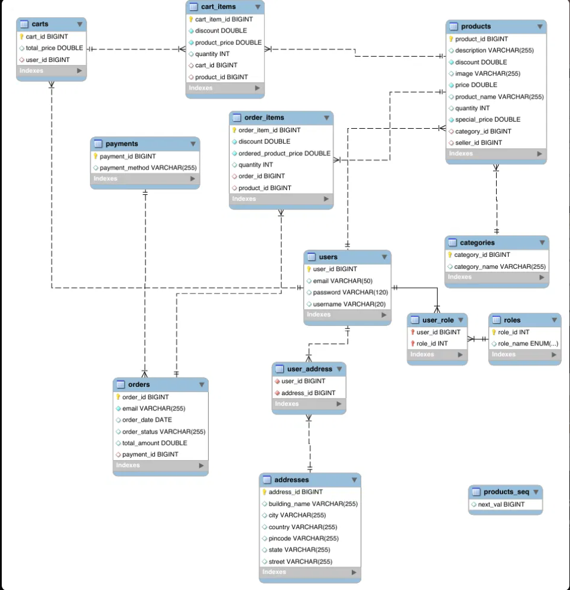
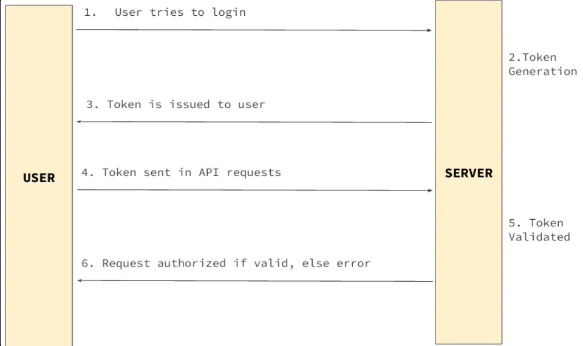
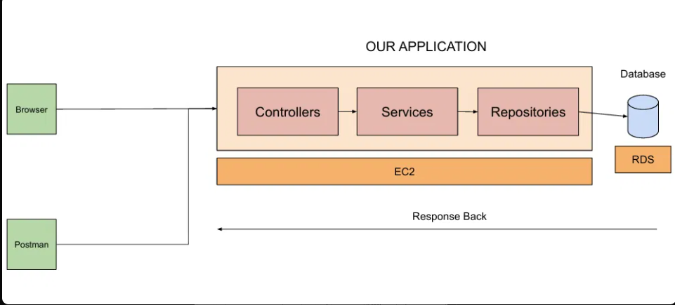

<div align="center">
<<<<<<< HEAD
🛍️ ShopSphere — E-Commerce REST API
A Java 21 and Spring Boot backend for an online shopping application


Repository: shopsphere-springboot-ecommerce-api · Author: Akash Sonu
</div>
---
Table of contents
Project overview
Features
Technology stack
Architecture
Application modules
API reference
Database design
Authentication and security
Project structure
Getting started
Configuration and secrets
Run and test the application
AWS deployment notes
Screenshots and diagrams
Known implementation notes
Possible improvements
Author
🚀 Project overview
ShopSphere is a RESTful e-commerce backend developed with Java 21 and Spring Boot 3.2.5. It provides APIs for user registration and authentication, product and category management, shopping carts, customer addresses, and order placement.
The application uses a layered structure to separate request handling, business logic, persistence, and security. Spring Data JPA and Hibernate are used to work with a MySQL database. DTOs are used for API request and response models, and Swagger UI provides interactive API documentation.
> This repository contains the backend API. A separate frontend application is not included in the uploaded project source.
✨ Features
User signup, signin, signout, and current-user information endpoints.
JWT-based authentication using Spring Security and an HTTP cookie.
Category creation, listing, updating, and deletion endpoints.
Product creation, listing, category filtering, keyword search, updating, deletion, and image upload.
Shopping-cart operations: add products, view carts, change quantities, and remove cart items.
Customer address create, read, update, and delete operations.
Order placement using the customer's cart, delivery address, and payment details supplied in the request.
Pagination and sorting for category and product listing endpoints.
DTO/entity mapping using ModelMapper.
Request validation using Jakarta Bean Validation.
Centralized exception handling through custom exception classes and a global exception handler.
Interactive API documentation using Springdoc OpenAPI / Swagger UI.
Payment scope: The code stores payment-related fields such as payment method, payment gateway name, payment ID, status, and response message. The uploaded source does not establish an integration with a live payment provider, so this project is described as accepting payment details rather than processing real payments through a gateway.
🧰 Technology stack
Technology	Usage
Java 21	Application language
Spring Boot 3.2.5	Application framework and auto-configuration
Spring Web	REST controllers and HTTP endpoints
Spring Security	Request authentication and security filter chain
JJWT 0.12.5	JWT creation and validation
Spring Data JPA	Repository abstraction and persistence
Hibernate	JPA implementation / ORM
MySQL Connector/J	MySQL connectivity
MySQL	Relational database
Maven	Dependency management and build
ModelMapper 3.0.0	DTO/entity mapping
Lombok	Boilerplate code reduction
Jakarta Validation	Request validation
Springdoc OpenAPI 2.5.0	OpenAPI specification and Swagger UI
JUnit / Spring Boot Test	Test dependencies
🏗️ Architecture
The application follows a layered architecture:
=======

# 🛍️ ShopSphere — E-Commerce REST API

**A Java 21 and Spring Boot backend for an online shopping application**

[](https://www.oracle.com/java/)
[](https://spring.io/projects/spring-boot)
[](https://www.mysql.com/)
[](https://spring.io/projects/spring-security)
[](https://springdoc.org/)

**Repository:** [shopsphere-springboot-ecommerce-api](https://github.com/akashsonu0/shopsphere-springboot-ecommerce-api) · **Author:** [Akash Sonu](https://github.com/akashsonu0)

</div>

---

## Table of contents

- [Project overview](#-project-overview)
- [Features](#-features)
- [Technology stack](#-technology-stack)
- [Architecture](#-architecture)
- [Application modules](#-application-modules)
- [API reference](#-api-reference)
- [Database design](#-database-design)
- [Authentication and security](#-authentication-and-security)
- [Project structure](#-project-structure)
- [Getting started](#-getting-started)
- [Configuration and secrets](#-configuration-and-secrets)
- [Run and test the application](#-run-and-test-the-application)
- [AWS deployment notes](#-aws-deployment-notes)
- [Screenshots and diagrams](#-screenshots-and-diagrams)
- [Known implementation notes](#-known-implementation-notes)
- [Possible improvements](#-possible-improvements)
- [Author](#-author)

## 🚀 Project overview

ShopSphere is a **RESTful e-commerce backend** developed with Java 21 and Spring Boot 3.2.5. It provides APIs for user registration and authentication, product and category management, shopping carts, customer addresses, and order placement.

The application uses a layered structure to separate request handling, business logic, persistence, and security. Spring Data JPA and Hibernate are used to work with a MySQL database. DTOs are used for API request and response models, and Swagger UI provides interactive API documentation.

> This repository contains the backend API. A separate frontend application is not included in the uploaded project source.

## ✨ Features

- User signup, signin, signout, and current-user information endpoints.
- JWT-based authentication using Spring Security and an HTTP cookie.
- Category creation, listing, updating, and deletion endpoints.
- Product creation, listing, category filtering, keyword search, updating, deletion, and image upload.
- Shopping-cart operations: add products, view carts, change quantities, and remove cart items.
- Customer address create, read, update, and delete operations.
- Order placement using the customer's cart, delivery address, and payment details supplied in the request.
- Pagination and sorting for category and product listing endpoints.
- DTO/entity mapping using ModelMapper.
- Request validation using Jakarta Bean Validation.
- Centralized exception handling through custom exception classes and a global exception handler.
- Interactive API documentation using Springdoc OpenAPI / Swagger UI.

**Payment scope:** The code stores payment-related fields such as payment method, payment gateway name, payment ID, status, and response message. The uploaded source does not establish an integration with a live payment provider, so this project is described as accepting payment details rather than processing real payments through a gateway.

## 🧰 Technology stack

| Technology | Usage |
|---|---|
| Java 21 | Application language |
| Spring Boot 3.2.5 | Application framework and auto-configuration |
| Spring Web | REST controllers and HTTP endpoints |
| Spring Security | Request authentication and security filter chain |
| JJWT 0.12.5 | JWT creation and validation |
| Spring Data JPA | Repository abstraction and persistence |
| Hibernate | JPA implementation / ORM |
| MySQL Connector/J | MySQL connectivity |
| MySQL | Relational database |
| Maven | Dependency management and build |
| ModelMapper 3.0.0 | DTO/entity mapping |
| Lombok | Boilerplate code reduction |
| Jakarta Validation | Request validation |
| Springdoc OpenAPI 2.5.0 | OpenAPI specification and Swagger UI |
| JUnit / Spring Boot Test | Test dependencies |

## 🏗️ Architecture

The application follows a layered architecture:

>>>>>>> fcade05 (Update README documentation)
```text
Client (Browser / Postman / Frontend)
                 |
                 v
          REST Controllers
                 |
                 v
           Service Layer
       (Interfaces + Implementations)
                 |
                 v
        Spring Data Repositories
                 |
                 v
              MySQL
```
<<<<<<< HEAD
Layer responsibilities
Layer / package	Responsibility
`controller`	Maps HTTP requests to application operations and returns responses.
`service`	Contains business operations and coordinates repositories.
`repositories`	Uses Spring Data JPA to read and write persistent data.
`model`	Defines JPA entities and relationships.
`payload`	Holds DTOs and API response models.
`security`	Configures Spring Security, JWT filtering, authentication services, and request/response classes.
`config`	Defines application constants, ModelMapper, and OpenAPI configuration.
`exceptions`	Defines application exceptions and global exception handling.
`util`	Contains shared helpers, including authentication utilities.

Request lifecycle
A client sends an HTTP request to an API endpoint.
Spring Security applies the configured request rules and the JWT filter checks the authentication token.
The matching controller validates/binds request data and calls a service.
The service performs the relevant business operation.
A repository communicates with MySQL through Spring Data JPA and Hibernate when persistence is required.
The result is mapped to a response DTO and returned to the client.

🧩 Application modules
1. Authentication
Implemented in `AuthController`, `WebSecurityConfig`, and the `security` package.
Register a user with `POST /api/auth/signup`.
Authenticate with `POST /api/auth/signin`.
Clear the JWT cookie with `POST /api/auth/signout`.
Retrieve the authenticated username and user details.
Passwords are encoded with BCrypt through Spring Security's `PasswordEncoder`.
2. Categories
Implemented in `CategoryController`, `CategoryService`, and `CategoryServiceImpl`.
Create and update categories.
Retrieve categories with pagination and sorting.
Delete a category through the admin URL path.
3. Products
Implemented in `ProductController`, `ProductService`, and `ProductServiceImpl`.
Add products under a category.
Retrieve products with pagination and sorting.
Retrieve products by category.
Search products by keyword.
Update and delete products.
Upload or update a product image using multipart form data.
4. Shopping cart
Implemented in `CartController` and `CartService`.
Add a product with a requested quantity.
Retrieve cart data.
Retrieve the current user's cart.
Increase or decrease a product quantity.
Remove a product from a cart.
5. Addresses
Implemented in `AddressController` and `AddressService`.
Create an address for the authenticated user.
Retrieve address records and the current user's addresses.
Retrieve, update, and delete an address by ID.
6. Orders and payment details
Implemented in `OrderController` and `OrderServiceImpl`.
Place an order using the user's cart and a delivery address.
Create order and order-item records.
Store the supplied payment method and payment-related details.
Reduce product stock based on the quantities ordered and remove ordered items from the cart.
📡 API reference
The following table is based on the controller mappings in the uploaded source. Request schemas and response bodies are available through Swagger UI.
Authentication — `/api/auth`
Method	Endpoint	Description	Access configured
`POST`	`/api/auth/signup`	Register a user	Public
`POST`	`/api/auth/signin`	Authenticate and issue JWT cookie	Public
`POST`	`/api/auth/signout`	Clear JWT cookie	Public
`GET`	`/api/auth/username`	Get authenticated username	Public path matcher; controller uses authentication context
`GET`	`/api/auth/user`	Get authenticated user's ID, username, and roles	Public path matcher; controller uses authentication context
Categories
Method	Endpoint	Description	Access configured
`GET`	`/api/public/categories`	List categories with pagination and sorting	Public
`POST`	`/api/public/categories`	Create a category	Public path
`PUT`	`/api/public/categories/{categoryId}`	Update a category	Public path
`DELETE`	`/api/admin/categories/{categoryId}`	Delete a category	Authentication required
Products
Method	Endpoint	Description	Access configured
`POST`	`/api/admin/categories/{categoryId}/product`	Add a product under a category	Authentication required
`GET`	`/api/public/products`	List products with pagination and sorting	Public
`GET`	`/api/public/categories/{categoryId}/products`	List products in a category	Public
`GET`	`/api/public/products/keyword/{keyword}`	Search products by keyword	Public
`PUT`	`/api/admin/products/{productId}`	Update a product	Authentication required
`DELETE`	`/api/admin/products/{productId}`	Delete a product	Authentication required
`PUT`	`/api/products/{productId}/image`	Upload/update a product image (`multipart/form-data`, field `image`)	Authentication required
Shopping cart
Method	Endpoint	Description	Access configured
`POST`	`/api/carts/products/{productId}/quantity/{quantity}`	Add product and quantity to cart	Authentication required
`GET`	`/api/carts`	Retrieve carts	Authentication required
`GET`	`/api/carts/users/cart`	Retrieve current user's cart	Authentication required
`PUT`	`/api/cart/products/{productId}/quantity/{operation}`	Increase/decrease product quantity	Authentication required
`DELETE`	`/api/carts/{cartId}/product/{productId}`	Remove product from a cart	Authentication required
For the cart quantity update endpoint, the controller treats `operation=delete` as a decrement; other values currently increase the quantity by one.
Addresses
Method	Endpoint	Description	Access configured
`POST`	`/api/addresses`	Create an address	Authentication required
`GET`	`/api/addresses`	Retrieve addresses	Authentication required
`GET`	`/api/addresses/{addressId}`	Retrieve an address by ID	Authentication required
`GET`	`/api/users/addresses`	Retrieve the current user's addresses	Authentication required
`PUT`	`/api/addresses/{addressId}`	Update an address	Authentication required
`DELETE`	`/api/addresses/{addressId}`	Delete an address	Authentication required
Orders
Method	Endpoint	Description	Access configured
`POST`	`/api/order/users/payments/{paymentMethod}`	Place an order using the supplied payment method and order request body	Authentication required
Pagination and sorting
Category and product listing endpoints accept these query parameters:
Parameter	Purpose	Default in code
`pageNumber`	Zero-based page number	`0`
`pageSize`	Number of records per page	`50`
`sortBy`	Entity field used for sorting	Category: `categoryId`; Product: `productId`
`sortOrder`	Sort direction	`asc`
Example:
```http
GET /api/public/products?pageNumber=0\&pageSize=10\&sortBy=price\&sortOrder=asc
```
> \*\*Security note:\*\* “Access configured” reflects the URL rules in `WebSecurityConfig`, not a guarantee of role-based authorization. In the uploaded configuration, `/api/auth/\*\*` and `/api/public/\*\*` are permitted; other endpoints require authentication. `@EnableMethodSecurity` is commented out, and the configuration does not define separate admin/seller role matchers. Review and strengthen these rules before production use.
🗄️ Database design
The uploaded project defines these JPA entities:
Entity	Purpose
`User`	User profile and credentials
`Role`	Application roles (`ROLE\_USER`, `ROLE\_SELLER`, `ROLE\_ADMIN`)
`Category`	Product category
`Product`	Product details, stock, pricing, image, category and seller association
`Cart`	A user's shopping cart
`CartItem`	Product and quantity stored in a cart
`Address`	Customer delivery address
`Order`	Order header, date, amount, status and address
`OrderItem`	Products and quantities included in an order
`Payment`	Payment method and payment-related reference/status fields

🔐 Authentication and security
The application configures stateless Spring Security with a JWT filter. The sign-in controller returns a JWT cookie in the response `Set-Cookie` header. The JWT utility also contains logic to read a bearer token from the `Authorization` header.

Authentication endpoint reference:

Before production deployment, review these settings in the current source:
The JWT cookie is currently configured with `httpOnly(false)` and `secure(false)`. For a production HTTPS deployment, use secure cookie settings and review the appropriate `SameSite` policy.
CSRF protection is disabled in the current security configuration. Reassess this when using cookie-based authentication.
The current `application.properties` contains hardcoded database credentials and a JWT signing secret. Replace them with environment-based configuration and rotate any values that have been committed or shared.
The current `CommandLineRunner` seeds demo user, seller, and admin accounts with fixed credentials. Remove or isolate this seeding for production.
The current logging configuration enables DEBUG for Spring, Hibernate SQL, Spring Security, and the application package. Reduce verbosity in production.
📁 Project structure
=======

### Layer responsibilities

| Layer / package | Responsibility |
|---|---|
| `controller` | Maps HTTP requests to application operations and returns responses. |
| `service` | Contains business operations and coordinates repositories. |
| `repositories` | Uses Spring Data JPA to read and write persistent data. |
| `model` | Defines JPA entities and relationships. |
| `payload` | Holds DTOs and API response models. |
| `security` | Configures Spring Security, JWT filtering, authentication services, and request/response classes. |
| `config` | Defines application constants, ModelMapper, and OpenAPI configuration. |
| `exceptions` | Defines application exceptions and global exception handling. |
| `util` | Contains shared helpers, including authentication utilities. |


### Request lifecycle

1. A client sends an HTTP request to an API endpoint.
2. Spring Security applies the configured request rules and the JWT filter checks the authentication token.
3. The matching controller validates/binds request data and calls a service.
4. The service performs the relevant business operation.
5. A repository communicates with MySQL through Spring Data JPA and Hibernate when persistence is required.
6. The result is mapped to a response DTO and returned to the client.


## 🧩 Application modules

### 1. Authentication

Implemented in `AuthController`, `WebSecurityConfig`, and the `security` package.

- Register a user with `POST /api/auth/signup`.
- Authenticate with `POST /api/auth/signin`.
- Clear the JWT cookie with `POST /api/auth/signout`.
- Retrieve the authenticated username and user details.
- Passwords are encoded with BCrypt through Spring Security's `PasswordEncoder`.

### 2. Categories

Implemented in `CategoryController`, `CategoryService`, and `CategoryServiceImpl`.

- Create and update categories.
- Retrieve categories with pagination and sorting.
- Delete a category through the admin URL path.

### 3. Products

Implemented in `ProductController`, `ProductService`, and `ProductServiceImpl`.

- Add products under a category.
- Retrieve products with pagination and sorting.
- Retrieve products by category.
- Search products by keyword.
- Update and delete products.
- Upload or update a product image using multipart form data.

### 4. Shopping cart

Implemented in `CartController` and `CartService`.

- Add a product with a requested quantity.
- Retrieve cart data.
- Retrieve the current user's cart.
- Increase or decrease a product quantity.
- Remove a product from a cart.

### 5. Addresses

Implemented in `AddressController` and `AddressService`.

- Create an address for the authenticated user.
- Retrieve address records and the current user's addresses.
- Retrieve, update, and delete an address by ID.

### 6. Orders and payment details

Implemented in `OrderController` and `OrderServiceImpl`.

- Place an order using the user's cart and a delivery address.
- Create order and order-item records.
- Store the supplied payment method and payment-related details.
- Reduce product stock based on the quantities ordered and remove ordered items from the cart.

## 📡 API reference

The following table is based on the controller mappings in the uploaded source. Request schemas and response bodies are available through Swagger UI.

### Authentication — `/api/auth`

| Method | Endpoint | Description | Access configured |
|---|---|---|---|
| `POST` | `/api/auth/signup` | Register a user | Public |
| `POST` | `/api/auth/signin` | Authenticate and issue JWT cookie | Public |
| `POST` | `/api/auth/signout` | Clear JWT cookie | Public |
| `GET` | `/api/auth/username` | Get authenticated username | Public path matcher; controller uses authentication context |
| `GET` | `/api/auth/user` | Get authenticated user's ID, username, and roles | Public path matcher; controller uses authentication context |

### Categories

| Method | Endpoint | Description | Access configured |
|---|---|---|---|
| `GET` | `/api/public/categories` | List categories with pagination and sorting | Public |
| `POST` | `/api/public/categories` | Create a category | Public path |
| `PUT` | `/api/public/categories/{categoryId}` | Update a category | Public path |
| `DELETE` | `/api/admin/categories/{categoryId}` | Delete a category | Authentication required |

### Products

| Method | Endpoint | Description | Access configured |
|---|---|---|---|
| `POST` | `/api/admin/categories/{categoryId}/product` | Add a product under a category | Authentication required |
| `GET` | `/api/public/products` | List products with pagination and sorting | Public |
| `GET` | `/api/public/categories/{categoryId}/products` | List products in a category | Public |
| `GET` | `/api/public/products/keyword/{keyword}` | Search products by keyword | Public |
| `PUT` | `/api/admin/products/{productId}` | Update a product | Authentication required |
| `DELETE` | `/api/admin/products/{productId}` | Delete a product | Authentication required |
| `PUT` | `/api/products/{productId}/image` | Upload/update a product image (`multipart/form-data`, field `image`) | Authentication required |

### Shopping cart

| Method | Endpoint | Description | Access configured |
|---|---|---|---|
| `POST` | `/api/carts/products/{productId}/quantity/{quantity}` | Add product and quantity to cart | Authentication required |
| `GET` | `/api/carts` | Retrieve carts | Authentication required |
| `GET` | `/api/carts/users/cart` | Retrieve current user's cart | Authentication required |
| `PUT` | `/api/cart/products/{productId}/quantity/{operation}` | Increase/decrease product quantity | Authentication required |
| `DELETE` | `/api/carts/{cartId}/product/{productId}` | Remove product from a cart | Authentication required |

For the cart quantity update endpoint, the controller treats `operation=delete` as a decrement; other values currently increase the quantity by one.

### Addresses

| Method | Endpoint | Description | Access configured |
|---|---|---|---|
| `POST` | `/api/addresses` | Create an address | Authentication required |
| `GET` | `/api/addresses` | Retrieve addresses | Authentication required |
| `GET` | `/api/addresses/{addressId}` | Retrieve an address by ID | Authentication required |
| `GET` | `/api/users/addresses` | Retrieve the current user's addresses | Authentication required |
| `PUT` | `/api/addresses/{addressId}` | Update an address | Authentication required |
| `DELETE` | `/api/addresses/{addressId}` | Delete an address | Authentication required |

### Orders

| Method | Endpoint | Description | Access configured |
|---|---|---|---|
| `POST` | `/api/order/users/payments/{paymentMethod}` | Place an order using the supplied payment method and order request body | Authentication required |

### Pagination and sorting

Category and product listing endpoints accept these query parameters:

| Parameter | Purpose | Default in code |
|---|---|---|
| `pageNumber` | Zero-based page number | `0` |
| `pageSize` | Number of records per page | `50` |
| `sortBy` | Entity field used for sorting | Category: `categoryId`; Product: `productId` |
| `sortOrder` | Sort direction | `asc` |

Example:

```http
GET /api/public/products?pageNumber=0&pageSize=10&sortBy=price&sortOrder=asc
```

> **Security note:** “Access configured” reflects the URL rules in `WebSecurityConfig`, not a guarantee of role-based authorization. In the uploaded configuration, `/api/auth/**` and `/api/public/**` are permitted; other endpoints require authentication. `@EnableMethodSecurity` is commented out, and the configuration does not define separate admin/seller role matchers. Review and strengthen these rules before production use.

## 🗄️ Database design

The uploaded project defines these JPA entities:

| Entity | Purpose |
|---|---|
| `User` | User profile and credentials |
| `Role` | Application roles (`ROLE_USER`, `ROLE_SELLER`, `ROLE_ADMIN`) |
| `Category` | Product category |
| `Product` | Product details, stock, pricing, image, category and seller association |
| `Cart` | A user's shopping cart |
| `CartItem` | Product and quantity stored in a cart |
| `Address` | Customer delivery address |
| `Order` | Order header, date, amount, status and address |
| `OrderItem` | Products and quantities included in an order |
| `Payment` | Payment method and payment-related reference/status fields |


## 🔐 Authentication and security

The application configures stateless Spring Security with a JWT filter. The sign-in controller returns a JWT cookie in the response `Set-Cookie` header. The JWT utility also contains logic to read a bearer token from the `Authorization` header.


Authentication endpoint reference:


**Before production deployment, review these settings in the current source:**

- The JWT cookie is currently configured with `httpOnly(false)` and `secure(false)`. For a production HTTPS deployment, use secure cookie settings and review the appropriate `SameSite` policy.
- CSRF protection is disabled in the current security configuration. Reassess this when using cookie-based authentication.
- The current `application.properties` contains hardcoded database credentials and a JWT signing secret. Replace them with environment-based configuration and rotate any values that have been committed or shared.
- The current `CommandLineRunner` seeds demo user, seller, and admin accounts with fixed credentials. Remove or isolate this seeding for production.
- The current logging configuration enables DEBUG for Spring, Hibernate SQL, Spring Security, and the application package. Reduce verbosity in production.

## 📁 Project structure

>>>>>>> fcade05 (Update README documentation)
```text
sb-ecom/
├── src/
│   ├── main/
│   │   ├── java/com/ecommerce/project/
│   │   │   ├── config/
│   │   │   │   ├── AppConfig.java
│   │   │   │   ├── AppConstants.java
│   │   │   │   └── SwaggerConfig.java
│   │   │   ├── controller/
│   │   │   │   ├── AddressController.java
│   │   │   │   ├── AuthController.java
│   │   │   │   ├── CartController.java
│   │   │   │   ├── CategoryController.java
│   │   │   │   ├── OrderController.java
│   │   │   │   └── ProductController.java
│   │   │   ├── exceptions/
│   │   │   ├── model/
│   │   │   ├── payload/
│   │   │   ├── repositories/
│   │   │   ├── security/
│   │   │   │   ├── jwt/
│   │   │   │   ├── request/
│   │   │   │   ├── response/
│   │   │   │   └── services/
│   │   │   ├── service/
│   │   │   ├── util/
│   │   │   └── SbEcomApplication.java
│   │   └── resources/
│   │       └── application.properties
│   └── test/
├── images/                 # Product images uploaded by the application
├── mvnw
├── mvnw.cmd
└── pom.xml
```
<<<<<<< HEAD
The uploaded Eclipse/project screenshots are included below for reference. The source archive also contains a `bin/` directory with generated/duplicate project output; it is not shown as part of the recommended source layout.
⚙️ Getting started
Prerequisites
JDK 21
MySQL Server (8.x recommended)
Git
Maven Wrapper (included in the repository)
Eclipse IDE or another Java IDE (optional)
1. Clone the repository
=======

The uploaded Eclipse/project screenshots are included below for reference. The source archive also contains a `bin/` directory with generated/duplicate project output; it is not shown as part of the recommended source layout.

## ⚙️ Getting started

### Prerequisites

- JDK 21
- MySQL Server (8.x recommended)
- Git
- Maven Wrapper (included in the repository)
- Eclipse IDE or another Java IDE (optional)

### 1. Clone the repository

>>>>>>> fcade05 (Update README documentation)
```bash
git clone https://github.com/akashsonu0/shopsphere-springboot-ecommerce-api.git
cd shopsphere-springboot-ecommerce-api
```
<<<<<<< HEAD
2. Create the local database
The uploaded `application.properties` currently points to a MySQL database named `ecommerce`.
```sql
CREATE DATABASE ecommerce;
```
3. Configure database credentials and JWT secret
Important: The uploaded `application.properties` currently contains literal database credentials and a JWT secret. Do not copy those values into public documentation or commit them. Replace the sensitive values with your own local values, or preferably change the properties to environment placeholders such as:
```properties
spring.datasource.driver-class-name=com.mysql.cj.jdbc.Driver
spring.datasource.url=${DB\_URL}
spring.datasource.username=${DB\_USERNAME}
spring.datasource.password=${DB\_PASSWORD}

spring.app.jwtSecret=${JWT\_SECRET}
=======

### 2. Create the local database

The uploaded `application.properties` currently points to a MySQL database named `ecommerce`.

```sql
CREATE DATABASE ecommerce;
```

### 3. Configure database credentials and JWT secret

**Important:** The uploaded `application.properties` currently contains literal database credentials and a JWT secret. Do not copy those values into public documentation or commit them. Replace the sensitive values with your own local values, or preferably change the properties to environment placeholders such as:

```properties
spring.datasource.driver-class-name=com.mysql.cj.jdbc.Driver
spring.datasource.url=${DB_URL}
spring.datasource.username=${DB_USERNAME}
spring.datasource.password=${DB_PASSWORD}

spring.app.jwtSecret=${JWT_SECRET}
>>>>>>> fcade05 (Update README documentation)
spring.app.jwtExpirationMs=3000000
spring.ecom.app.jwtCookieName=springBootEcom

spring.jpa.hibernate.ddl-auto=update
spring.jpa.database-platform=org.hibernate.dialect.MySQLDialect
project.image=images/
server.port=5000
<<<<<<< HEAD
```
Then set the variables in the terminal where you will run the application.
Git Bash:
```bash
export DB\_URL="jdbc:mysql://localhost:3306/ecommerce"
export DB\_USERNAME="your\_mysql\_username"
export DB\_PASSWORD="your\_mysql\_password"
export JWT\_SECRET="your\_base64\_encoded\_jwt\_signing\_key"
./mvnw spring-boot:run
```
Windows PowerShell:
```powershell
$env:DB\_URL="jdbc:mysql://localhost:3306/ecommerce"
$env:DB\_USERNAME="your\_mysql\_username"
$env:DB\_PASSWORD="your\_mysql\_password"
$env:JWT\_SECRET="your\_base64\_encoded\_jwt\_signing\_key"
.\\mvnw.cmd spring-boot:run
```
The JWT secret must be a valid Base64-encoded key with sufficient strength for the HMAC algorithm used by JJWT. Generate and store your own secret securely; do not reuse a value from source control.
▶️ Run and test the application
Run from the Maven Wrapper
Git Bash / macOS / Linux:
```bash
./mvnw spring-boot:run
```
Windows:
```powershell
.\\mvnw.cmd spring-boot:run
```
Build the JAR
```bash
./mvnw clean package
```
On Windows:
```powershell
.\\mvnw.cmd clean package
```
Run the generated JAR (check the exact filename under `target/`):
```bash
java -jar target/sb-ecom-0.0.1-SNAPSHOT.jar
```
Swagger UI
The uploaded configuration sets `server.port=5000`.
Swagger UI: `http://localhost:5000/swagger-ui/index.html`
OpenAPI JSON: `http://localhost:5000/v3/api-docs`
Use Swagger UI to inspect request schemas, response models, and endpoint details. Because sign-in uses a JWT cookie, test authentication with a client that preserves and sends cookies, or use the bearer-token support only where it matches the filter's configured behaviour.
☁️ AWS deployment notes
The supplied deployment diagram and project context describe deployment through AWS Elastic Beanstalk with a MySQL database on Amazon RDS. The application listens on port `5000`, as configured for the Elastic Beanstalk environment.

For a production deployment:
Configure database URL, username, password, and JWT secret as environment variables in the hosting environment.
Restrict RDS inbound access to the application environment/security group rather than exposing the database publicly.
Use HTTPS for public traffic.
Use secure cookie settings when deploying behind HTTPS.
Avoid DEBUG-level security and SQL logs in production.
Use database migrations for controlled schema changes instead of relying on `ddl-auto=update` indefinitely.
A previously shared Swagger address was:
`http://my-app-env.eba-zdvy2nem.ap-southeast-2.elasticbeanstalk.com/swagger-ui/index.html`
This is an HTTP address and may not remain available. Treat it as a deployment reference, not a guaranteed uptime link.
🖼️ Screenshots and diagrams
Category API

Product API


Cart API

Address API


Project and IDE views


Configuration views


⚠️ Known implementation notes
These points are visible in the uploaded source and are worth addressing before presenting the application as production-ready:
Secrets in configuration: Database credentials and JWT signing material are hardcoded in the uploaded `application.properties`. Move them to environment variables and rotate any exposed values.
Demo account seeding: `WebSecurityConfig` creates demo user, seller, and admin records with fixed passwords at application startup. Keep this limited to local development or replace it with a safe, controlled bootstrap process.
Authorization granularity: The current filter chain permits the `/api/public/\*\*` and `/api/auth/\*\*` paths and requires authentication for other routes. It does not configure separate role restrictions for admin/seller endpoints, and method security is commented out.
JWT cookie flags: The current cookie is configured as non-HttpOnly and non-Secure. Review and change these settings for a real HTTPS deployment.
CSRF: CSRF is disabled while authentication uses a cookie. Review the threat model and configure CSRF protection appropriately for the final client architecture.
Logging: DEBUG logging is enabled for multiple framework and application packages. Use a less verbose production profile.
Image storage: Product images are written to the local `images/` directory. On ephemeral or multi-instance hosting, consider durable object storage and a shared delivery strategy.
Currency precision: Product/cart/order price fields use `double`/`Double`. `BigDecimal` is generally more appropriate for monetary values.
Tests: The uploaded test source contains the Spring Boot context test; add broader integration tests for authentication, authorization, cart operations, and order placement.
🔧 Possible improvements
Add role-based authorization rules for admin, seller, and user operations.
Add ownership checks so users can only access or modify their own carts and addresses.
Move secrets and environment-specific settings out of source control.
Add integration tests for important business flows.
Use `BigDecimal` for prices and monetary calculations.
Use a database migration tool such as Flyway or Liquibase.
Store uploaded product images in durable object storage for cloud deployments.
Add CI checks for tests, build, and code quality.
Add explicit payment-provider integration only if real payment processing is intended.
👨‍💻 Author
Akash Sonu  
GitHub: @akashsonu0  
Project: ShopSphere Spring Boot E-Commerce API
---
<div align="center">
Built with Java, Spring Boot, and a focus on learning backend development.
=======
```

Then set the variables in the terminal where you will run the application.

**Git Bash:**

```bash
export DB_URL="jdbc:mysql://localhost:3306/ecommerce"
export DB_USERNAME="your_mysql_username"
export DB_PASSWORD="your_mysql_password"
export JWT_SECRET="your_base64_encoded_jwt_signing_key"
./mvnw spring-boot:run
```

**Windows PowerShell:**

```powershell
$env:DB_URL="jdbc:mysql://localhost:3306/ecommerce"
$env:DB_USERNAME="your_mysql_username"
$env:DB_PASSWORD="your_mysql_password"
$env:JWT_SECRET="your_base64_encoded_jwt_signing_key"
.\mvnw.cmd spring-boot:run
```

The JWT secret must be a valid Base64-encoded key with sufficient strength for the HMAC algorithm used by JJWT. Generate and store your own secret securely; do not reuse a value from source control.

## ▶️ Run and test the application

### Run from the Maven Wrapper

**Git Bash / macOS / Linux:**

```bash
./mvnw spring-boot:run
```

**Windows:**

```powershell
.\mvnw.cmd spring-boot:run
```

### Build the JAR

```bash
./mvnw clean package
```

On Windows:

```powershell
.\mvnw.cmd clean package
```

Run the generated JAR (check the exact filename under `target/`):

```bash
java -jar target/sb-ecom-0.0.1-SNAPSHOT.jar
```

### Swagger UI

The uploaded configuration sets `server.port=5000`.

- Swagger UI: `http://localhost:5000/swagger-ui/index.html`
- OpenAPI JSON: `http://localhost:5000/v3/api-docs`

Use Swagger UI to inspect request schemas, response models, and endpoint details. Because sign-in uses a JWT cookie, test authentication with a client that preserves and sends cookies, or use the bearer-token support only where it matches the filter's configured behaviour.

## ☁️ AWS deployment notes

The supplied deployment diagram and project context describe deployment through **AWS Elastic Beanstalk** with a **MySQL database on Amazon RDS**. The application listens on port `5000`, as configured for the Elastic Beanstalk environment.


For a production deployment:

- Configure database URL, username, password, and JWT secret as environment variables in the hosting environment.
- Restrict RDS inbound access to the application environment/security group rather than exposing the database publicly.
- Use HTTPS for public traffic.
- Use secure cookie settings when deploying behind HTTPS.
- Avoid DEBUG-level security and SQL logs in production.
- Use database migrations for controlled schema changes instead of relying on `ddl-auto=update` indefinitely.

A previously shared Swagger address was:

`http://my-app-env.eba-zdvy2nem.ap-southeast-2.elasticbeanstalk.com/swagger-ui/index.html`

This is an HTTP address and may not remain available. Treat it as a deployment reference, not a guaranteed uptime link.

## 🖼️ Screenshots and diagrams

### Category API


### Product API


### Cart API


### Address API


### Project and IDE views


### Configuration views


## ⚠️ Known implementation notes

These points are visible in the uploaded source and are worth addressing before presenting the application as production-ready:

1. **Secrets in configuration:** Database credentials and JWT signing material are hardcoded in the uploaded `application.properties`. Move them to environment variables and rotate any exposed values.
2. **Demo account seeding:** `WebSecurityConfig` creates demo user, seller, and admin records with fixed passwords at application startup. Keep this limited to local development or replace it with a safe, controlled bootstrap process.
3. **Authorization granularity:** The current filter chain permits the `/api/public/**` and `/api/auth/**` paths and requires authentication for other routes. It does not configure separate role restrictions for admin/seller endpoints, and method security is commented out.
4. **JWT cookie flags:** The current cookie is configured as non-HttpOnly and non-Secure. Review and change these settings for a real HTTPS deployment.
5. **CSRF:** CSRF is disabled while authentication uses a cookie. Review the threat model and configure CSRF protection appropriately for the final client architecture.
6. **Logging:** DEBUG logging is enabled for multiple framework and application packages. Use a less verbose production profile.
7. **Image storage:** Product images are written to the local `images/` directory. On ephemeral or multi-instance hosting, consider durable object storage and a shared delivery strategy.
8. **Currency precision:** Product/cart/order price fields use `double`/`Double`. `BigDecimal` is generally more appropriate for monetary values.
9. **Tests:** The uploaded test source contains the Spring Boot context test; add broader integration tests for authentication, authorization, cart operations, and order placement.

## 🔧 Possible improvements

- Add role-based authorization rules for admin, seller, and user operations.
- Add ownership checks so users can only access or modify their own carts and addresses.
- Move secrets and environment-specific settings out of source control.
- Add integration tests for important business flows.
- Use `BigDecimal` for prices and monetary calculations.
- Use a database migration tool such as Flyway or Liquibase.
- Store uploaded product images in durable object storage for cloud deployments.
- Add CI checks for tests, build, and code quality.
- Add explicit payment-provider integration only if real payment processing is intended.

## 👨‍💻 Author

**Akash Sonu**  
GitHub: [@akashsonu0](https://github.com/akashsonu0)  
Project: [ShopSphere Spring Boot E-Commerce API](https://github.com/akashsonu0/shopsphere-springboot-ecommerce-api)

---

<div align="center">

**Built with Java, Spring Boot, and a focus on learning backend development.**

>>>>>>> fcade05 (Update README documentation)
</div>
