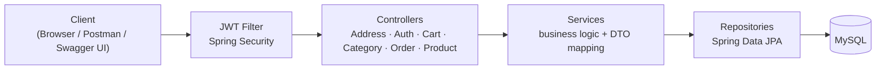
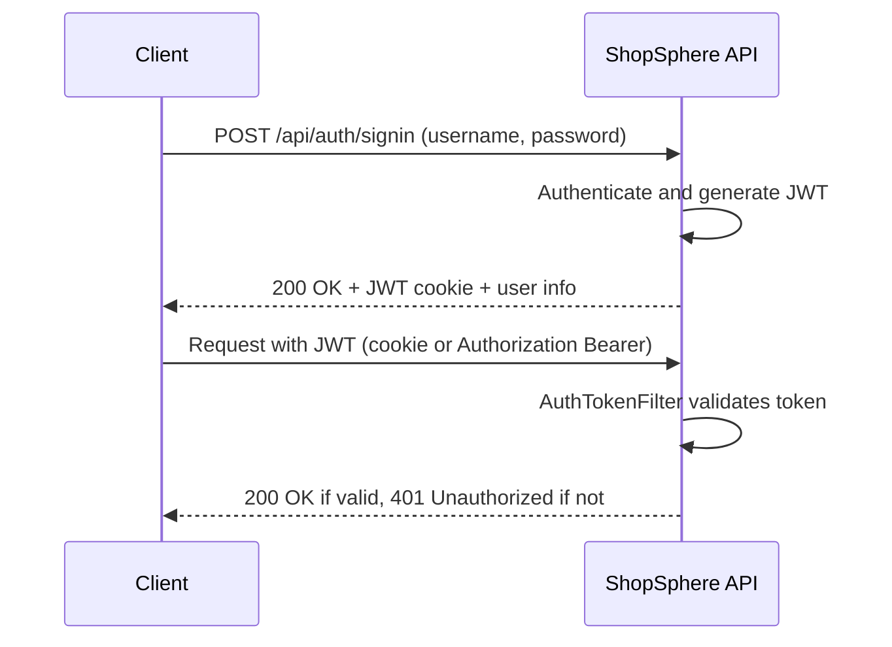
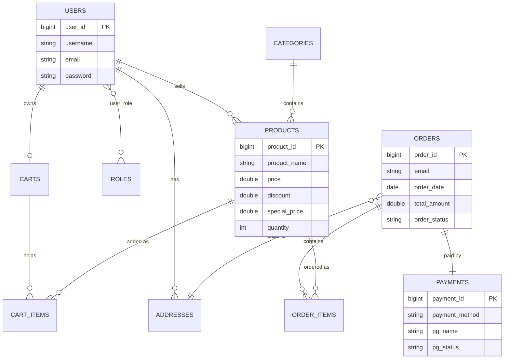
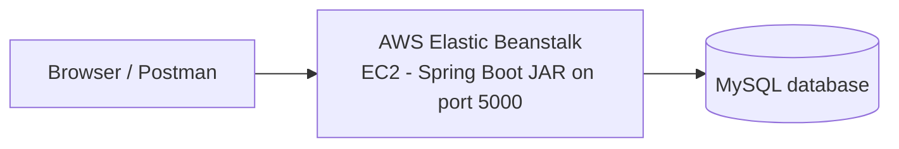

<h1 align="center">🛍️ ShopSphere – Spring Boot E-Commerce REST API</h1>
<p align="center">
  A secure e-commerce backend built with <b>Spring Boot 3</b>, <b>Spring Security + JWT</b>, <b>JPA/Hibernate</b> and <b>MySQL</b>,<br/>
  documented with <b>Swagger (OpenAPI 3)</b> and deployed on <b>AWS</b>.
</p>
<p align="center">
  
  
  
  
  
  
</p>
<p align="center">
  <a href="http://my-app-env.eba-zdvy2nem.ap-southeast-2.elasticbeanstalk.com/swagger-ui/index.html"><b>🔗 Live Swagger API Documentation</b></a>
</p>
---
📑 Table of Contents
About · Features · Tech Stack · Architecture · Database · API Reference · Run Locally · Auth Guide · Deployment · Roadmap · Author
---
📖 About the Project
ShopSphere is a RESTful backend for an online store. Users can register and sign in, browse products by category, keep a shopping cart, save delivery addresses and place orders with payment-gateway details. Sellers and admins manage the product catalogue.
It demonstrates a clean Controller → Service → Repository architecture, DTO-based request/response handling, stateless JWT security, global exception handling, pagination & sorting, and cloud deployment.
---
✨ Features
🔐 JWT authentication – sign up, sign in (JWT returned as a cookie), sign out, current-user info
👥 Role model – `ROLE_USER`, `ROLE_SELLER`, `ROLE_ADMIN` assigned at signup
🗂️ Categories – create, list (paginated & sorted), update, delete
📦 Products – add to a category, list, filter by category, search by keyword, update, delete, upload image
🛒 Shopping cart – add items, increase/decrease quantity, remove items, automatic total price
📍 Address book – full CRUD, multiple addresses per user
💳 Order placement – payment method plus payment-gateway details
⚠️ Global exception handling with consistent error responses
✅ Bean validation on request bodies
📘 Swagger UI for interactive testing
☁️ Deployed on AWS (Elastic Beanstalk + MySQL)
---
🧰 Tech Stack
Layer	Technology
Language	Java 21
Framework	Spring Boot 3.2.5 (Web, Data JPA, Validation)
Security	Spring Security, JWT (jjwt 0.12.5), BCrypt
Database	MySQL
ORM	Hibernate / Spring Data JPA
Mapping	ModelMapper 3.0.0
API Docs	springdoc-openapi 2.5.0 (Swagger UI)
Build	Maven (wrapper included)
Utilities	Lombok
Cloud	AWS Elastic Beanstalk / EC2, MySQL database
---
🏗️ Architecture

Authentication flow

Project structure
```
shopsphere-springboot-ecommerce-api
├── src/main/java/com/ecommerce/project
│   ├── config            # AppConfig, AppConstants, SwaggerConfig
│   ├── controller        # Address, Auth, Cart, Category, Order, Product
│   ├── exceptions        # APIException, ResourceNotFoundException, global handler
│   ├── model             # JPA entities
│   ├── payload           # DTOs and response wrappers
│   ├── repositories      # Spring Data JPA repositories
│   ├── security          # WebSecurityConfig, jwt/, request/, response/, services/
│   ├── service           # Service interfaces + implementations
│   └── util              # AuthUtil
├── src/main/resources
│   └── application.properties.example
├── docs/images           # README screenshots
└── pom.xml
```
---
🗃️ Database Design

---
📚 API Reference
Base path: `/api` · Interactive docs: Swagger UI
Swagger screenshots
Overview	Authentication
	

Categories & Products	Cart, Address & Orders
	
🔑 Authentication – `/api/auth`
Method	Endpoint	Description	Access
POST	`/api/auth/signup`	Register a new user	Public
POST	`/api/auth/signin`	Log in, returns JWT cookie + user info	Public
POST	`/api/auth/signout`	Log out (clears cookie)	Public
GET	`/api/auth/username`	Current username	Public route, needs a valid JWT
GET	`/api/auth/user`	Current user details	Public route, needs a valid JWT
🗂️ Categories
Method	Endpoint	Description	Access
GET	`/api/public/categories`	List categories (`pageNumber`, `pageSize`, `sortBy`, `sortOrder`)	Public
POST	`/api/public/categories`	Create a category	Public
PUT	`/api/public/categories/{categoryId}`	Update a category	Public
DELETE	`/api/admin/categories/{categoryId}`	Delete a category	Authenticated
📦 Products
Method	Endpoint	Description	Access
POST	`/api/admin/categories/{categoryId}/product`	Add a product to a category	Authenticated
GET	`/api/public/products`	List all products (paginated)	Public
GET	`/api/public/categories/{categoryId}/products`	Products by category	Public
GET	`/api/public/products/keyword/{keyword}`	Search products by keyword	Public
PUT	`/api/admin/products/{productId}`	Update a product	Authenticated
PUT	`/api/products/{productId}/image`	Upload product image (`multipart/form-data`, field `image`)	Authenticated
DELETE	`/api/admin/products/{productId}`	Delete a product	Authenticated
🛒 Cart
Method	Endpoint	Description	Access
POST	`/api/carts/products/{productId}/quantity/{quantity}`	Add product to cart	Authenticated
GET	`/api/carts`	List all carts	Authenticated
GET	`/api/carts/users/cart`	Logged-in user's cart	Authenticated
PUT	`/api/cart/products/{productId}/quantity/{operation}`	Update quantity (`add` / `delete`)	Authenticated
DELETE	`/api/carts/{cartId}/product/{productId}`	Remove product from cart	Authenticated
📍 Addresses
Method	Endpoint	Description	Access
POST	`/api/addresses`	Create an address	Authenticated
GET	`/api/addresses`	List all addresses	Authenticated
GET	`/api/addresses/{addressId}`	Get address by ID	Authenticated
GET	`/api/users/addresses`	Logged-in user's addresses	Authenticated
PUT	`/api/addresses/{addressId}`	Update an address	Authenticated
DELETE	`/api/addresses/{addressId}`	Delete an address	Authenticated
🧾 Orders
Method	Endpoint	Description	Access
POST	`/api/order/users/payments/{paymentMethod}`	Place an order	Authenticated
<details>
<summary><b>Sample request – place an order</b></summary>
```json
POST /api/order/users/payments/UPI
{
  "addressId": 1,
  "pgName": "Razorpay",
  "pgPaymentId": "pay_123456",
  "pgStatus": "success",
  "pgResponseMessage": "Payment successful"
}
```
</details>
---
🚀 Getting Started
Prerequisites
Java 21 · MySQL 8+ · Git (Maven wrapper is included)
1. Clone
```bash
git clone https://github.com/akashsonu0/shopsphere-springboot-ecommerce-api.git
cd shopsphere-springboot-ecommerce-api
```
2. Create the database
```sql
CREATE DATABASE ecommerce;
```
3. Configure
```bash
cp src/main/resources/application.properties.example src/main/resources/application.properties
```
Edit `application.properties` and set your DB username/password and a Base64 JWT secret:
```bash
openssl rand -base64 48
```
> `application.properties` is git-ignored, so your secrets are never published.
4. Run
```bash
./mvnw spring-boot:run          # Git Bash / Linux / macOS
mvnw.cmd spring-boot:run        # Windows CMD
```
API: `http://localhost:5000`
Swagger UI: `http://localhost:5000/swagger-ui/index.html`
On first start the app creates the three roles and a few demo accounts (`user1`, `seller1`, `admin`). See `WebSecurityConfig.initData` for details and change or remove these before any real deployment.
---
🔐 Authentication Guide
Create an account with `POST /api/auth/signup` (or use a seeded demo account locally).
Call `POST /api/auth/signin`. The JWT is stored in the `springBootEcom` cookie.
In Swagger UI the browser sends that cookie automatically. In Postman, either keep the cookie or send `Authorization: Bearer <token>`.
Call any protected endpoint.
---
☁️ Deployment

```bash
./mvnw clean package -DskipTests
# upload target/sb-ecom-0.0.1-SNAPSHOT.jar to Elastic Beanstalk
```
Configure these environment properties in Elastic Beanstalk (no secrets live in the repo): `DB_URL`, `DB_USERNAME`, `DB_PASSWORD`, `JWT_SECRET`.
---
🗺️ Roadmap
[ ] Enforce role-based access (`@EnableMethodSecurity` + `@PreAuthorize`) on admin/seller routes
[ ] Unit and integration tests
[ ] Docker + GitHub Actions CI/CD
[ ] Real payment-gateway integration (Razorpay / Stripe)
[ ] Order history and status tracking
[ ] React frontend
---
👨‍💻 Author
Akash Sonu

⭐ If you found this project useful, please give it a star!