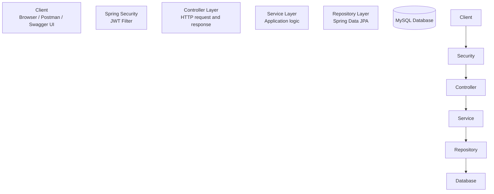

<h1 align="center">🛍️ ShopSphere — E-Commerce REST API</h1>
<p align="center">
  A Spring Boot REST API for an online store, featuring authentication, product discovery,
  shopping carts, addresses, and order placement.
</p>
<p align="center">
  <a href="https://github.com/akashsonu0/shopsphere-springboot-ecommerce-api">
    
  </a>
  
  
  
  
  
</p>
<p align="center">
  <a href="http://my-app-env.eba-zdvy2nem.ap-southeast-2.elasticbeanstalk.com/swagger-ui/index.html"><strong>🚀 Open Live Swagger UI</strong></a>
  \&nbsp;•\&nbsp;
  <a href="https://github.com/akashsonu0">GitHub Profile</a>
</p>
> \*\*Deployment note:\*\* The deployed Swagger URL above uses HTTP. Its availability may change, and browsers or networks may handle it differently. For local development, use the local Swagger URL described below.
---
📌 About the Project
ShopSphere is a backend project for an e-commerce application. It exposes REST endpoints for user authentication, product and category browsing, cart management, customer addresses, and order placement.
The codebase is organized using a layered architecture:
Controller → Service → Repository → MySQL
It also uses request/response DTOs, Spring Security with JWT-based authentication, centralized exception handling, request validation, and Swagger/OpenAPI documentation.
This project is intended as a practical example of building and documenting a Java/Spring Boot REST API.
✨ Features
Authentication APIs — sign up, sign in, sign out, and retrieve authenticated-user information.
JWT-based request security — Spring Security configuration and a JWT request filter.
Product catalogue — browse products, filter products by category, search by keyword, manage product details, and upload product images.
Category management — create, list, update, and delete categories; listing supports pagination and sorting where configured.
Shopping cart — add products, retrieve cart information, change quantities, and remove items.
Address management — create, retrieve, update, and delete addresses.
Order placement — submit an order request with an address, payment method, and payment-gateway-related fields.
DTO-based API contracts — separate payload classes for API data and persistence entities.
Validation and exception handling — Jakarta Bean Validation and centralized exception handling.
Interactive API documentation — Swagger UI powered by OpenAPI.
Relational persistence — MySQL through Spring Data JPA and Hibernate.
AWS deployment setup — deployment architecture documented for Elastic Beanstalk and a MySQL database.
> Access requirements vary by endpoint. Check the application's security configuration and the live/local Swagger documentation rather than assuming every write endpoint is protected or public.
🧰 Technology Stack
Technology	Purpose
Java 21	Application language
Spring Boot 3.2.5	Application configuration and auto-configuration
Spring Web	REST controllers and HTTP endpoints
Spring Security	Authentication and request security
JJWT	JWT creation and validation
Spring Data JPA	Repository abstraction and persistence
Hibernate	ORM implementation
MySQL	Relational database
Maven Wrapper	Build and dependency management
springdoc-openapi / Swagger UI	API documentation and interactive testing
ModelMapper	DTO/entity mapping
Jakarta Bean Validation	Request validation
Lombok	Reduces Java boilerplate
AWS Elastic Beanstalk / Amazon RDS	Deployment architecture
🏗️ Architecture

Layer responsibilities
Package	Responsibility
`controller`	Receives HTTP requests, validates/binds input, and returns responses
`service`	Contains application logic and coordinates operations
`repositories`	Accesses persisted data through Spring Data JPA
`model`	JPA entities such as `User`, `Product`, `Category`, `Cart`, and `Order`
`payload`	Request DTOs, response DTOs, and API response objects
`security`	Spring Security configuration, JWT handling, and user-details services
`config`	Application constants, bean configuration, and Swagger configuration
`exceptions`	Custom exceptions and centralized exception handling
`util`	Shared helper classes, including authentication utilities
Request lifecycle
A client sends an HTTP request.
Spring Security applies the configured request rules and JWT filter.
The relevant controller handles the request.
The service layer performs the required application logic.
Repositories read or write data through JPA/Hibernate.
The application maps the result to a response and returns an HTTP status/body.
Architecture diagram

DTO and entity flow

🗃️ Data Model
The project includes entities for:
Users and roles
Products and categories
Carts and cart items
Orders and order items
Payments
Addresses

📚 API Reference
The deployed Swagger UI is the most convenient place to inspect request schemas, response bodies, HTTP status codes, and endpoint details:
Open Live Swagger UI
After starting the application locally, open:
Swagger UI: `http://localhost:5000/swagger-ui/index.html`
OpenAPI JSON: `http://localhost:5000/v3/api-docs`
Authentication — `/api/auth`
Method	Endpoint	Purpose
`POST`	`/api/auth/signup`	Register a user
`POST`	`/api/auth/signin`	Authenticate a user
`POST`	`/api/auth/signout`	Clear the authentication cookie
`GET`	`/api/auth/username`	Retrieve the authenticated username
`GET`	`/api/auth/user`	Retrieve authenticated-user information
Categories
Method	Endpoint	Purpose
`GET`	`/api/public/categories`	List categories
`POST`	`/api/public/categories`	Create a category
`PUT`	`/api/public/categories/{categoryId}`	Update a category
`DELETE`	`/api/admin/categories/{categoryId}`	Delete a category
Products
Method	Endpoint	Purpose
`GET`	`/api/public/products`	List products
`GET`	`/api/public/categories/{categoryId}/products`	List products in a category
`GET`	`/api/public/products/keyword/{keyword}`	Search products by keyword
`POST`	`/api/admin/categories/{categoryId}/product`	Add a product to a category
`PUT`	`/api/admin/products/{productId}`	Update a product
`PUT`	`/api/products/{productId}/image`	Upload a product image
`DELETE`	`/api/admin/products/{productId}`	Delete a product
Shopping cart
Method	Endpoint	Purpose
`POST`	`/api/carts/products/{productId}/quantity/{quantity}`	Add a product to a cart
`GET`	`/api/carts`	Retrieve carts
`GET`	`/api/carts/users/cart`	Retrieve the current user's cart
`PUT`	`/api/cart/products/{productId}/quantity/{operation}`	Update a cart item's quantity
`DELETE`	`/api/carts/{cartId}/product/{productId}`	Remove a product from a cart
Addresses
Method	Endpoint	Purpose
`POST`	`/api/addresses`	Create an address
`GET`	`/api/addresses`	List addresses
`GET`	`/api/addresses/{addressId}`	Retrieve an address
`GET`	`/api/users/addresses`	Retrieve the current user's addresses
`PUT`	`/api/addresses/{addressId}`	Update an address
`DELETE`	`/api/addresses/{addressId}`	Delete an address
Orders
Method	Endpoint	Purpose
`POST`	`/api/order/users/payments/{paymentMethod}`	Place an order
Important: This is a quick endpoint overview, not a replacement for the actual API contract. Confirm authorization requirements, payload fields, and response codes in `WebSecurityConfig` and Swagger UI. Payment-gateway fields in a request do not by themselves mean a live payment provider is integrated.
🚀 Getting Started
Prerequisites
Install the following before running the project:
JDK 21
MySQL (a compatible MySQL 8 installation is recommended)
Git
An IDE such as Eclipse or IntelliJ IDEA (optional)
Check Java and Git:
```bash
java -version
git --version
```
1. Clone the repository
```bash
git clone https://github.com/akashsonu0/shopsphere-springboot-ecommerce-api.git
cd shopsphere-springboot-ecommerce-api
```
2. Create a local database
Log in to MySQL and run:
```sql
CREATE DATABASE shopsphere;
```
3. Configure environment variables
The application configuration expects these environment variables:
`DB\_URL`
`DB\_USERNAME`
`DB\_PASSWORD`
`JWT\_SECRET`
For a local MySQL database, the JDBC URL will usually look like:
```text
jdbc:mysql://localhost:3306/shopsphere
```
Git Bash (Windows), macOS, or Linux
Set the variables in the same terminal session before starting the app:
```bash
export DB\_URL="jdbc:mysql://localhost:3306/shopsphere"
export DB\_USERNAME="your\_local\_db\_username"
export DB\_PASSWORD="your\_local\_db\_password"
export JWT\_SECRET="replace\_with\_a\_strong\_secret"
```
Then start the application:
```bash
./mvnw spring-boot:run
```
Windows PowerShell
```powershell
$env:DB\_URL="jdbc:mysql://localhost:3306/shopsphere"
$env:DB\_USERNAME="your\_local\_db\_username"
$env:DB\_PASSWORD="your\_local\_db\_password"
$env:JWT\_SECRET="replace\_with\_a\_strong\_secret"

.\\mvnw.cmd spring-boot:run
```
Use a strong, randomly generated JWT secret that meets the JWT library's key-strength requirements. Never commit real credentials or reuse production secrets in development.
4. Open Swagger UI
The application is configured to use port `5000` in the supplied configuration.
Swagger UI: `http://localhost:5000/swagger-ui/index.html`
OpenAPI JSON: `http://localhost:5000/v3/api-docs`
If you change `server.port`, adjust these URLs accordingly.
🔐 Authentication Guide
The authentication controller supports sign-up and sign-in. The implementation uses a JWT cookie for authentication.
Register through `POST /api/auth/signup`.
Sign in through `POST /api/auth/signin`.
Keep the returned authentication cookie when making subsequent requests.
Use the authenticated endpoints in Swagger UI or Postman.
Depending on the client and current security configuration, Swagger UI may send the cookie automatically. In Postman, check the cookie jar and the endpoint's configured authentication requirements.
> \*\*Security note:\*\* Before using this project in a real environment, review role assignments, access rules, and ownership checks for operations involving products, carts, addresses, and orders. Never publish seeded/demo credentials or production secrets.
🧪 Build and Run the JAR
Build the project with the Maven Wrapper.
Git Bash / macOS / Linux:
```bash
./mvnw clean package
```
Windows Command Prompt:
```bat
mvnw.cmd clean package
```
The generated JAR should be in the `target/` directory. Run the filename produced by your build; for example:
```bash
java -jar target/sb-ecom-0.0.1-SNAPSHOT.jar
```
If the JAR name differs, list the contents of `target/` and use the correct filename.
☁️ Deployment
The project includes an architecture diagram for deployment on AWS Elastic Beanstalk with a MySQL database such as Amazon RDS.

For a deployment:
Build the application JAR.
Configure `DB\_URL`, `DB\_USERNAME`, `DB\_PASSWORD`, and `JWT\_SECRET` in the hosting environment.
Configure database network access so only the required application environment can connect.
Confirm the application port and health-check configuration match the hosting setup.
Use HTTPS for public traffic and avoid exposing database credentials.
The diagram documents the intended deployment architecture; actual availability and infrastructure settings may change.
🖼️ API and Authentication Screenshots
JWT authentication flow

Authentication endpoints

Category endpoints

Product endpoints


Cart endpoints

Address endpoints


🛠️ Possible Improvements
These are potential future enhancements, not claims that they are already implemented:
Add broader unit and integration tests for authentication, authorization, cart operations, and order placement.
Review role-based permissions and resource-ownership checks for sensitive operations.
Use database migrations for controlled schema changes.
Use `BigDecimal` for monetary values and calculations.
Add CI checks to build the project and run tests automatically.
Configure HTTPS and managed secrets in deployment.
Add a real payment-provider integration if payment processing is required.
👨‍💻 Author
Akash Sonu
GitHub: @akashsonu0
Repository: shopsphere-springboot-ecommerce-api
---
If you find this project useful, consider giving the repository a ⭐.