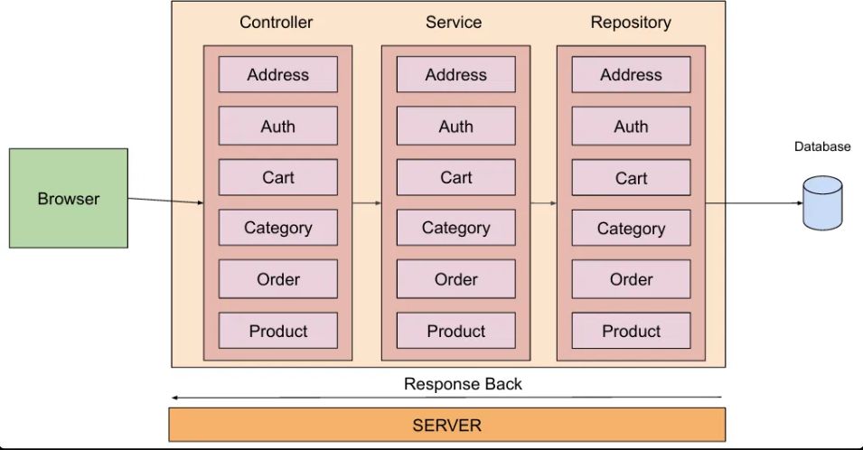
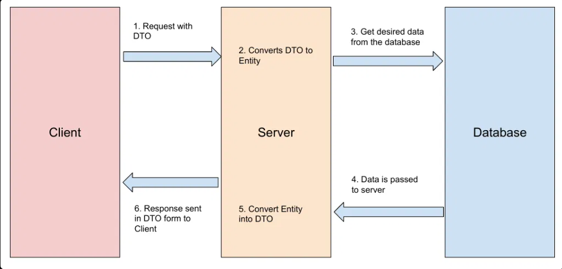
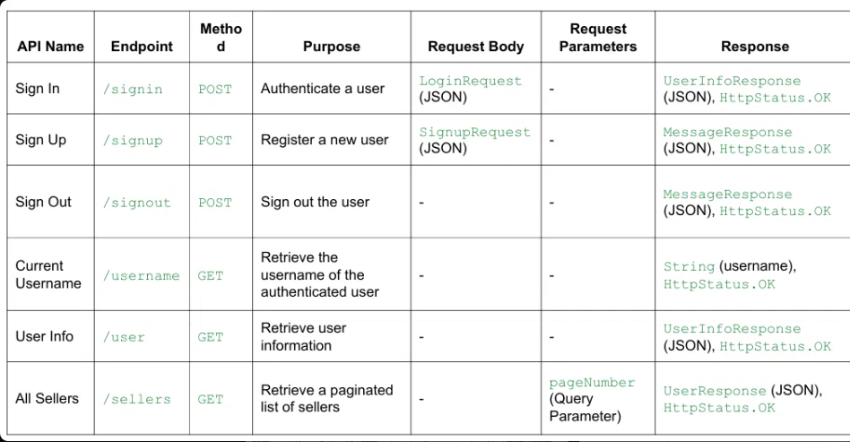
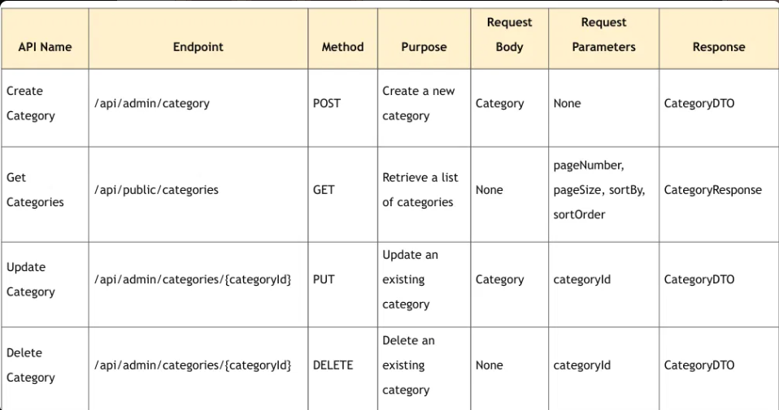
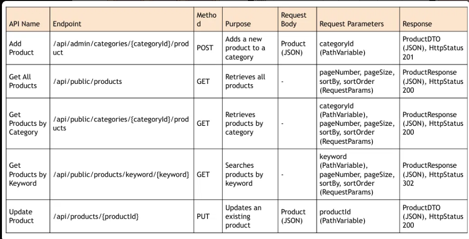
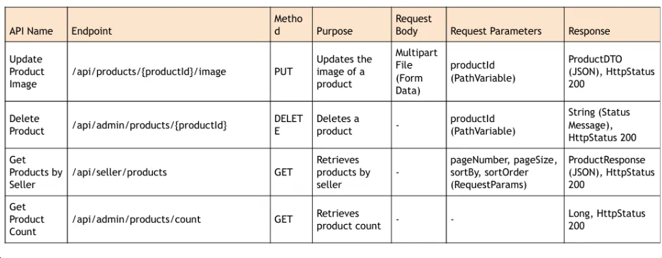
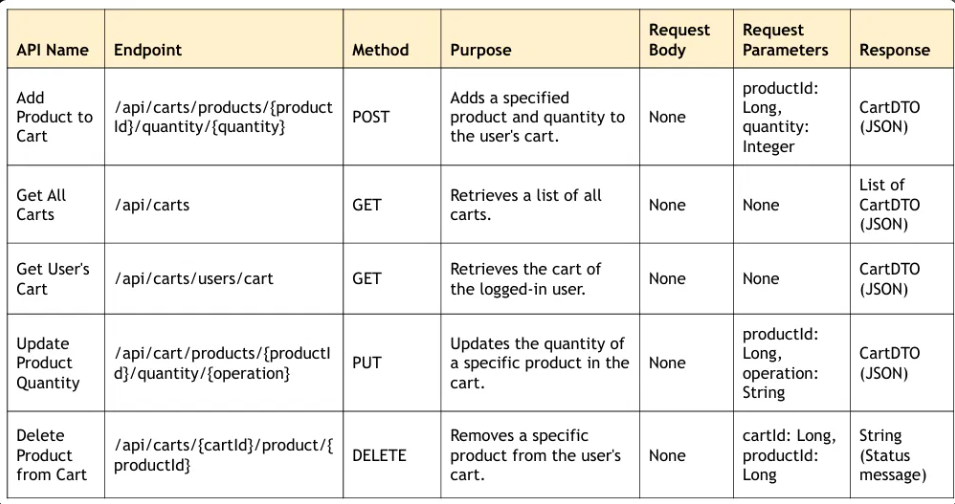
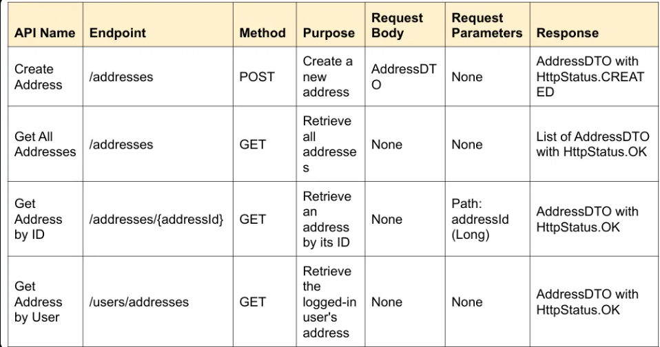
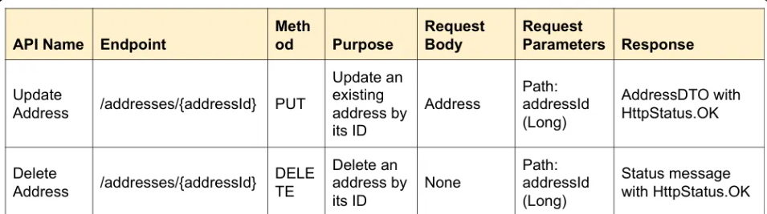

<h1 align="center">🛍️ ShopSphere – Spring Boot E-Commerce REST API</h1>
<p align="center">
  A secure e-commerce backend built with <b>Spring Boot 3</b>, <b>Spring Security + JWT</b>, <b>JPA/Hibernate</b> and <b>MySQL</b>,<br/>
  documented with <b>Swagger (OpenAPI 3)</b> and deployed on <b>AWS</b>.
</p>
<p align="center">
  
  
  
  
  
  
</p>
<p align="center">
  <a href="http://my-app-env.eba-zdvy2nem.ap-southeast-2.elasticbeanstalk.com/swagger-ui/index.html"><b>🔗 Live Swagger API Documentation</b></a>
</p>
---
Overview
ShopSphere is a RESTful e-commerce backend organized around a layered
architecture. It exposes APIs for user authentication, product and
category management, shopping carts, customer addresses, and order
placement. The codebase separates HTTP handling, business logic, and
database access into controller, service, and repository layers.
> \*\*API documentation:\*\* \[Open the deployed Swagger
> UI](http://my-app-env.eba-zdvy2nem.ap-southeast-2.elasticbeanstalk.com/swagger-ui/index.html).
> The deployment URL is currently HTTP, so availability and browser
> behavior may vary. You can also run the application locally and open
> the local Swagger UI.
Table of contents
Highlights
Technology stack
Architecture
Request lifecycle
API overview
Data model
Project structure
Run locally
Environment configuration
Build and run the JAR
Deployment
Visual documentation
Potential next steps
Author
Highlights
Authentication: sign-up, sign-in, sign-out, and
authenticated-user information.
JWT and Spring Security: token-based authentication and request
filtering.
Product APIs: browse products, search by keyword, filter by
category, update product details, and upload product images.
Category APIs: category creation, updates, deletion, and
paginated listing.
Cart APIs: add products, retrieve carts, update quantities, and
remove cart items.
Address APIs: create, retrieve, update, and delete addresses.
Order APIs: order placement and payment-method request handling.
DTO-based API contracts: payload classes separate API
request/response data from persistence entities.
Validation and error handling: Jakarta Bean Validation and
centralized exception handling.
Interactive API docs: Swagger UI / OpenAPI through springdoc.
Persistence: MySQL through Spring Data JPA and Hibernate.
Technology stack
Technology                    Role in the project
---
Java 21                       Application language
Spring Boot 3.2.5             Application setup and auto-configuration
Spring Web                    REST controllers and HTTP APIs
Spring Security               Authentication and endpoint security
JJWT 0.12.5                   JWT creation and validation
Spring Data JPA / Hibernate   ORM and database persistence
MySQL                         Relational database
Maven                         Dependency management and build
springdoc-openapi 2.5.0       OpenAPI specification and Swagger UI
ModelMapper                   DTO/entity mapping
Jakarta Bean Validation       Request validation
Lombok                        Boilerplate reduction
Architecture
The project follows a layered backend design:
``` text
Client (Browser / Postman)
          |
          v
   REST Controllers
          |
          v
   Service Interfaces
          |
          v
 Service Implementations
          |
          v
 Spring Data Repositories
          |
          v
        MySQL
```
Layer responsibilities
---
Layer                               Responsibility
---
`controller`                        Accepts HTTP requests, binds
request data, and returns HTTP
responses.
`service`                           Holds application/business logic
and coordinates operations.
`repositories`                      Reads and writes data using Spring
Data JPA.
`model`                             Contains JPA entities such as
`User`, `Product`, `Category`,
`Cart`, and `Order`.
`payload`                           Contains DTOs and response models
used by the API.
`security`                          Configures Spring Security and the
JWT request flow.
`config`                            Contains application constants,
bean configuration, and Swagger
configuration.
`exceptions`                        Contains custom exceptions and
global exception handling.
`util`                              Contains shared utilities,
including authentication-related
helpers.

Request lifecycle
A client sends an HTTP request.
Spring Security processes the request and applies the configured
authentication rules.
The controller receives the request and calls the relevant service.
The service performs application logic and calls a repository when
persistence is needed.
The repository accesses MySQL through JPA/Hibernate.
The application maps the result to a response DTO and returns an
HTTP response.

API overview
This table summarizes key endpoint groups. Use Swagger UI as the source
of truth for full schemas, status codes, and authorization requirements.
---
Module           Example endpoint                                                       Method Purpose
---
Authentication   `/api/auth/signup`                                                     `POST` Register a user
Authentication   `/api/auth/signin`                                                     `POST` Authenticate a user
Authentication   `/api/auth/signout`                                                    `POST` Sign out / clear the
authentication
cookie
Authentication   `/api/auth/username`                                                    `GET` Retrieve the
authenticated
username
Authentication   `/api/auth/user`                                                        `GET` Retrieve
authenticated-user
information
Categories       `/api/public/categories`                                                `GET` List categories with
pagination/sorting
Products         `/api/public/products`                                                  `GET` List products with
pagination/sorting
Products         `/api/public/categories/{categoryId}/products`                          `GET` List products for a
category
Products         `/api/public/products/keyword/{keyword}`                                `GET` Search products by
keyword
Cart             `/api/carts/products/{productId}/quantity/{quantity}`                  `POST` Add a product to the
cart
Cart             `/api/carts/users/cart`                                                 `GET` Retrieve the
logged-in user's
cart
Addresses        `/api/addresses`                                                       `POST` Create an address
Addresses        `/api/users/addresses`                                                  `GET` Retrieve the
logged-in user's
addresses
Orders           `/api/order/users/payments/{paymentMethod}`                            `POST` Place an order using
a payment method
Important API notes
Some endpoints are intended for authenticated users or specific
roles.
Do not assume every endpoint is public. Check `WebSecurityConfig`
and Swagger descriptions for the actual rules.
The project configures JWT cookies. Test authentication in
Swagger/Postman according to the implementation.
Exact response codes and schemas vary by endpoint; inspect the
OpenAPI docs for the current contract.
Data model
The visible schema includes users and roles, products and categories,
carts and cart items, orders and order items, payments, and addresses.

Project structure
``` text
sb-ecom/
├── src/
│   ├── main/
│   │   ├── java/com/ecommerce/project/
│   │   │   ├── config/                  # App configuration and Swagger
│   │   │   ├── controller/              # Address, Auth, Cart, Category,
│   │   │   │                            # Order, and Product controllers
│   │   │   ├── exceptions/              # Custom exceptions and global handler
│   │   │   ├── model/                   # JPA entities and role model
│   │   │   ├── payload/                 # DTOs and response objects
│   │   │   ├── repositories/            # Spring Data JPA repositories
│   │   │   ├── security/
│   │   │   │   ├── jwt/                 # JWT filter, utilities, entry point
│   │   │   │   ├── request/             # Login and signup payloads
│   │   │   │   ├── response/            # Authentication/user responses
│   │   │   │   └── services/            # User-details services
│   │   │   ├── service/                 # Service interfaces/implementations
│   │   │   ├── util/                    # Shared utilities
│   │   │   └── SbEcomApplication.java   # Application entry point
│   │   └── resources/
│   │       └── application.properties   # Environment-based configuration
│   └── test/
├── images/                              # Architecture and API diagrams
├── .gitignore
├── mvnw
├── mvnw.cmd
└── pom.xml
```
Run locally
Prerequisites
JDK 21
Git
MySQL Server
Eclipse or another Java IDE (optional)
Verify Java and Git:
``` bash
java -version
git --version
```
1. Clone the repository
``` bash
git clone https://github.com/akashsonu0/shopsphere-springboot-ecommerce-api.git
cd shopsphere-springboot-ecommerce-api
```
2. Create a database
``` sql
CREATE DATABASE shopsphere;
```
Use a dedicated local database user where practical.
3. Set environment variables
The application expects `DB\_URL`, `DB\_USERNAME`, `DB\_PASSWORD`, and
`JWT\_SECRET`.
For local MySQL, `DB\_URL` typically looks like:
``` text
jdbc:mysql://localhost:3306/shopsphere
```
Windows PowerShell example (values apply only to the current
terminal session):
``` powershell
$env:DB\_URL="jdbc:mysql://localhost:3306/shopsphere"
$env:DB\_USERNAME="your\_local\_db\_username"
$env:DB\_PASSWORD="your\_local\_db\_password"
$env:JWT\_SECRET="replace\_with\_a\_strong\_secret\_compatible\_with\_your\_jwt\_library"
.\\mvnw.cmd spring-boot:run
```
Git Bash example:
``` bash
export DB\_URL="jdbc:mysql://localhost:3306/shopsphere"
export DB\_USERNAME="your\_local\_db\_username"
export DB\_PASSWORD="your\_local\_db\_password"
export JWT\_SECRET="replace\_with\_a\_strong\_secret\_compatible\_with\_your\_jwt\_library"
./mvnw spring-boot:run
```
Use a strong, randomly generated JWT secret that meets the JWT library's
key-strength requirements. Do not reuse a production secret in local
development.
4. Open Swagger UI
The project is configured for port `5000`.
Swagger UI: `http://localhost:5000/swagger-ui/index.html`
OpenAPI JSON: `http://localhost:5000/v3/api-docs`
If you change `server.port`, update these URLs.
Environment configuration
The main configuration reads database credentials and the JWT signing
secret from environment variables:
``` properties
spring.datasource.url=${DB\_URL}
spring.datasource.username=${DB\_USERNAME}
spring.datasource.password=${DB\_PASSWORD}
spring.app.jwtSecret=${JWT\_SECRET}
```
Other settings in the supplied configuration include:
`spring.jpa.hibernate.ddl-auto=update`
`spring.app.jwtExpirationMs=3000000`
`spring.ecom.app.jwtCookieName=springBootEcom`
`project.image=images/`
`server.port=5000`
Production checklist
Keep secrets out of source control and rotate any secret that has
already been committed.
Use HTTPS for public traffic.
Reduce verbose debug logging, especially security-related logs.
Restrict database access to the application environment and trusted
sources.
Consider database migrations instead of `ddl-auto=update` for
production schema changes.
Review authentication, role permissions, and resource-ownership
checks for sensitive operations.
Build and run the JAR
Windows:
``` bash
mvnw.cmd clean package
```
Git Bash / macOS / Linux:
``` bash
./mvnw clean package
```
The JAR should be generated in `target/`. Run it using the actual
filename produced by the build, for example:
``` bash
java -jar target/sb-ecom-0.0.1-SNAPSHOT.jar
```
If the filename differs, check `target/` and use the generated name.
Deployment
The supplied deployment diagram describes an AWS Elastic Beanstalk
application connected to MySQL on Amazon RDS.

Configure secrets in the hosting environment rather than committing
them. Verify that the RDS security group allows access only from the
required application environment and that public traffic uses HTTPS.
Visual documentation
Authentication and JWT flow

Authentication endpoints

Category endpoints

Product endpoints


Cart endpoints

Address endpoints


Potential next steps
These are suggested future improvements, not claims that they are
already implemented:
Add integration tests for authentication, authorization, cart
operations, and order placement.
Review role-based access control and ownership checks for sensitive
operations.
Add database migrations for repeatable schema changes.
Use `BigDecimal` for currency calculations instead of floating-point
types.
Add consistent validation and error-response examples to API
documentation.
Add CI checks to run tests and package the application.
Configure HTTPS and managed secrets for deployment.
Author
Akash Sonu
GitHub: @akashsonu0
Project repository:
shopsphere-springboot-ecommerce-api
License
No license is specified in this repository at the time of writing. Add a
`LICENSE` file if you intend to grant others permission to reuse,
modify, or distribute the project.